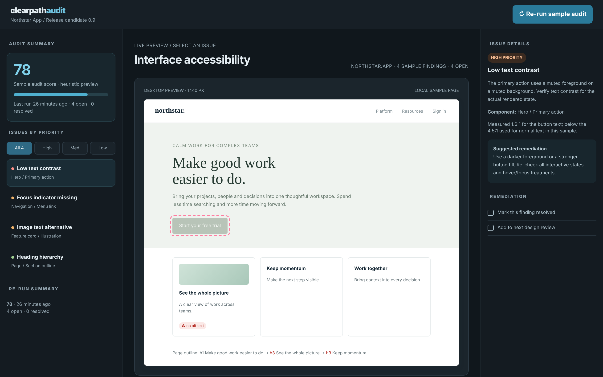

# Clearpath Audit

Make accessibility visible, testable and part of the build.

An ACRYL Blends blueprint for the **Accessibility** category (`acrylblends.accessibility-clearpath-audit`, category 69 of 100): an accessibility audit and assistive-preview console with sample findings filtered by priority, a live sample page that outlines the affected component, high-contrast, larger-text and focus-outline previews, remediation that is applied to the preview, and a re-run score.



## Who it is for

Accessibility specialists, QA teams, designers and product owners.

## Start it

```sh
npm create acrylblends@latest my-accessibility -- --from acrylblends.accessibility-clearpath-audit
cd my-accessibility
npm install
npm start      # the app on its own server; npm run dev opens it in the ACRYL frame
npm test       # domain and route tests
```

The first start seeds Northstar App's release candidate with four findings (low text contrast, missing focus indicator, image text alternative, heading hierarchy) and a first run scoring 78. State is saved as JSON in the app's data home (`.acrylblends/clearpath.json`); delete it to start over.

## What it does

| Screen | Path | What you can do |
| --- | --- | --- |
| Audit summary and re-run | left rail and top bar | The heuristic score of the last run with its bar, the number of resolved and queued findings, and **Re-run sample audit** with the latest runs listed. |
| Issues by priority | left rail | Filter by All, High, Med or Low (`?severity=`) and pick a finding (`?issue=`). |
| Live preview | `/` | The sample page with the affected component of the open finding outlined; **High contrast preview**, **Larger text** and **Show focus outlines** are saved view settings. |
| Issue details and remediation | right column | Severity, description, what was measured, the suggested remediation, and the checklist: **Mark this finding resolved** (the fix appears in the preview) and **Add to next design review**. |

The score is 100 minus 10 for each open high finding, 5 for each medium and 2 for each low; it changes only when the sample audit is re-run, and each run records the change since the previous one. The contrast figure is the WCAG relative-luminance ratio of the sample button's colours (1.6:1 before the fix, above 9:1 after), compared with the 4.5:1 used for normal text in this sample.

## How it is made

Composed from Cordis plugins only; `blend.yaml` reads as what the app is made of:

| Row | Folder | Job |
| --- | --- | --- |
| `clearpath` | `plugins/clearpath/` | The domain (`ctx.audit`): findings, view settings, measurements, scoring and runs, saved as JSON in the app's data home. |
| `audit-shell` | `plugins/audit-shell/` | The shell (`ctx.auditShell`): the top bar, the rail, the preview and the detail column; side parts are registered by other plugins. |
| `summary`, `issues` | `plugins/<name>/` | The rail. |
| `preview` | `plugins/preview/` | The first page and the view setting route. |
| `detail`, `rerun` | `plugins/<name>/` | The right column, and Re-run in the top bar and rail. |

## Prototype boundaries

This is a sample issue-triage concept, not an automated conformance certificate. Passing the visible demo checks does not prove WCAG compliance, so no criterion numbers are claimed, and nothing here infers disability or health from interaction.

## Ask the chat next

1. "Add a finding editor: create a finding with a severity, a component and a suggested fix, and show it as a new target in the preview."
2. "Add a keyboard walkthrough mode to the preview that steps focus through the sample page's controls and records the order."
3. "Export the audit as a Markdown report with the open findings, the remediation notes and the score history."

Design: `design/spec.md` and `design/mockup.html`.
