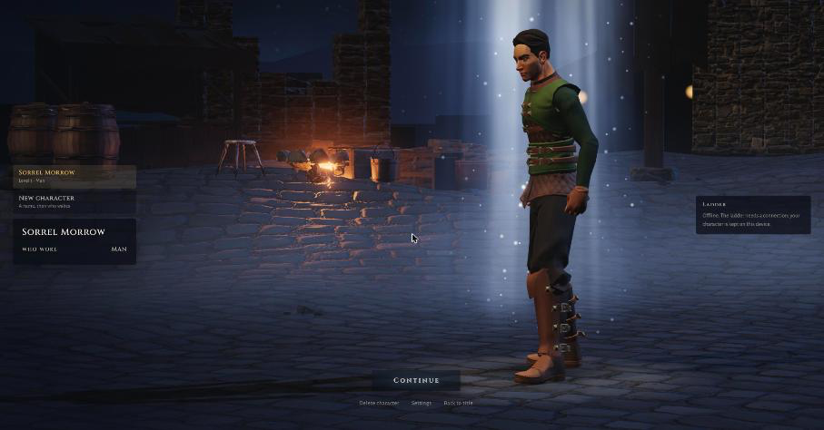

# Action RPG

An isometric action RPG: fight under a night storm, find loot, level up and shape your character on a skill tree of 125 places.



A Blend for [acrylblends](https://acrylblends.github.io): a whole app whose first screen is the game. Start your own copy, play it, and change it
by hand or with the agents in the ACRYL frame.

## Start your copy

```bash
npm create acrylblends@latest my-action-rpg -- --from acrylblends.action-rpg
cd my-action-rpg
npm install
npm start      # the game on its own server, at the address it prints
npm run dev    # the game in the ACRYL frame, with the agents beside it
```

Or straight from this repository: `npm create acrylblends@latest my-action-rpg -- --from github:acrylblends/41-action-rpg`.

## Play

Left mouse moves, attacks and picks up; the Controls panel in the game lists the rest.

## How it is made

- `plugins/game/`: the game's files in `public/`, served at the app's root (`/` on its own server, `/app/` in the frame). A path the game
  does not have goes on to the app's own routes, so `/health` and `/about` still answer.
- `blend.yaml`: the app as data. The `game` row comes before `routes`, so the game owns the first screen; switch it off with `disabled: true`.
- Everything else is the acrylblends app: `npm test`, `npm run check`, `npm run save`.

## Credits and licence

Made from The Lost Storm (MIT); the 3D models and fonts are credited in `plugins/game/ASSETS.md`. MIT, see `LICENSE` and `NOTICE`.
