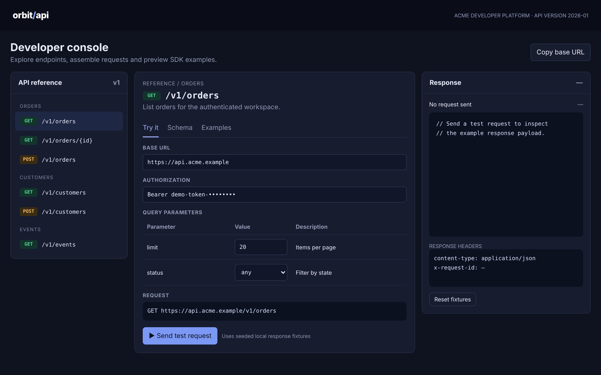

# Orbit API Console

Explore an API and shape your first SDK request.

An ACRYL Blends blueprint for the **API / SDK** category (`acrylblends.api-orbit-console`, category 60 of 100): a developer console with endpoint navigation, a request builder, schema and example docs, a response inspector, and JavaScript, Python and Go snippets built from what you typed.



## Who it is for

API consumers, SDK developers, integration engineers and platform documentation teams.

## Start it

```sh
npm create acrylblends@latest my-api-console -- --from acrylblends.api-orbit-console
cd my-api-console
npm install
npm start      # the app on its own server; npm run dev opens it in the ACRYL frame
npm test       # domain and route tests
```

The first start seeds a fixture API with six endpoints (orders, customers, events) over six orders, five customers and a few event deliveries. State is saved as JSON in the app's data home (`.acrylblends/orbit.json`); delete it to start over.

## What it does

| Screen | Path | What you can do |
| --- | --- | --- |
| API reference | left column | The endpoints grouped by resource; picking one selects it (`?endpoint=`) for every tab. |
| Try it | `/` | The base URL and token, the endpoint's query or path parameters and, for a POST, the request body, with the request line it will send. **Send test request** runs it against the fixture API; what you typed is remembered per endpoint. |
| Schema | `/schema` | The resource the endpoint returns (Order, Customer or Event) as a type map, and for a POST the body's fields and whether they are required. |
| Examples | `/examples` | A snippet in JavaScript, Python or Go (`?lang=`), built from the values typed in Try it, with **Copy snippet**. |
| Response | right column | The last response: status, timing, JSON body with highlighting, and headers; **Reset fixtures** puts the data back. |

The fixture API answers like a real one: `422` for a bad parameter or body (the message names the field), `404` for an unknown order, `409` for a repeated customer e-mail, `201` for a create. Creates change the data, so the next list shows the new order or customer. Latency is a fixed base plus a little per record.

## How it is made

Composed from Cordis plugins only; `blend.yaml` reads as what the app is made of:

| Row | Folder | Job |
| --- | --- | --- |
| `orbit` | `plugins/orbit/` | The domain (`ctx.orbit`): the endpoints, the fixture API and its request simulation, remembered inputs, the snippet generator, persistence behind a store port. |
| `orbit-shell` | `plugins/orbit-shell/` | The page shell (`ctx.orbitShell`): header, endpoint title, tabs, the three columns and the mockup's styles. |
| `reference`, `response` | `plugins/<name>/` | The left and right columns. |
| `try-it`, `schema`, `examples` | `plugins/<name>/` | One plugin per tab, each registering its tab so it leaves with the plugin. |

## Prototype boundaries

No request leaves the app and no real API is contacted; the token is a placeholder and the data are fixtures.

## Ask the chat next

1. "Add a Postman-style collection export: download the typed requests of every endpoint as a JSON file and import one back."
2. "Add a new endpoint, POST /v1/refunds, with its parameters, body schema, fixture rules and snippets, as a plugin."
3. "Add request history: keep the last twenty requests with their responses, and let me re-run or compare two of them."

Design: `design/spec.md` and `design/mockup.html`.
