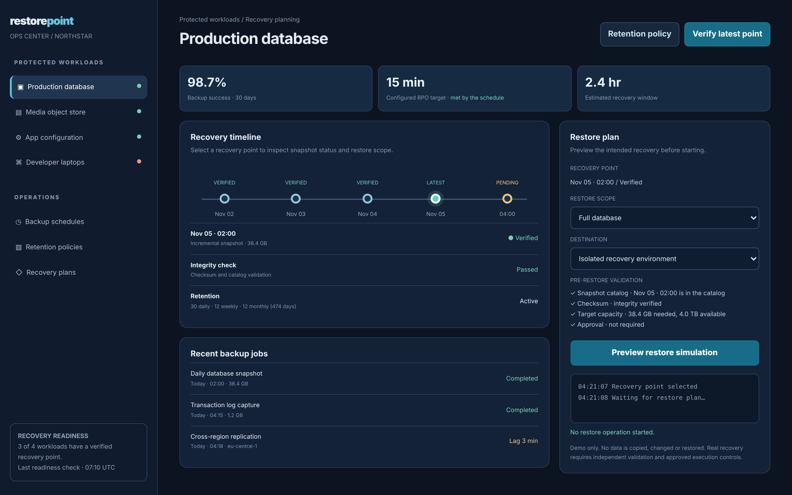

# Restorepoint

Know what is protected, and how quickly you can recover it.

An ACRYL Blends blueprint for the **Backup and recovery** category (`acrylblends.backup-restorepoint`, category 70 of 100): a backup operations and recovery-planning console with protected workloads, a recovery timeline with integrity status, backup schedules, retention policies, a restore plan with preflight checks and a simulated restore run.



## Who it is for

IT administrators, infrastructure teams and operations leads responsible for business continuity.

## Start it

```sh
npm create acrylblends@latest my-backup -- --from acrylblends.backup-restorepoint
cd my-backup
npm install
npm start      # the app on its own server; npm run dev opens it in the ACRYL frame
npm test       # domain and route tests
```

The first start seeds Northstar's four workloads (production database, media object store, app configuration, developer laptops): the database has four verified daily points and a pending one, and the laptops' newest point fails its integrity check, so 3 of 4 workloads are ready. State is saved as JSON in the app's data home (`.acrylblends/restorepoint.json`); delete it to start over.

## What it does

| Screen | Path | What you can do |
| --- | --- | --- |
| Protected workloads | left rail | The workloads with a readiness dot, and the readiness note: how many have a verified recovery point and when readiness was last checked. |
| Recovery | `/` | Stats (backup success, the RPO target and whether the schedule meets it, the recovery window), the recovery timeline (`?point=`) with the selected point's integrity, the recent backup jobs, and the restore plan: scope and destination, the preflight checks, **Preview restore simulation** and its log. **Verify latest point** runs the verification simulation. |
| Backup schedules | `/schedules` | Every job with its schedule and last run; **Pause** or **Resume** it. Pausing the jobs that meet the RPO puts the target at risk. |
| Retention policies | `/retention` | Daily, weekly and monthly points to keep and the RPO target per workload, with the days the policy reaches back. |
| Recovery plans | `/plans` | Every restore preview, newest first, with its result; a blocked one names the failed check. |

Backup completion, integrity verification and restore readiness are separate. A restore preview runs these preflight checks: the point is in the catalog, its checksum is verified, the destination has capacity for the scope (the scope's share of the point's size), and no approval is needed (production is always blocked in the simulation). A seeded defect makes a verification fail. The RPO is met when the shortest enabled job interval is no longer than the target. Retention keeps 1 to 90 daily, up to 52 weekly and up to 36 monthly points; the RPO is 5 to 1440 minutes.

## How it is made

Composed from Cordis plugins only; `blend.yaml` reads as what the app is made of:

| Row | Folder | Job |
| --- | --- | --- |
| `restorepoint` | `plugins/restorepoint/` | The domain (`ctx.ops`): workloads, recovery points, jobs, retention, preflight, verification and restore previews, saved as JSON in the app's data home. |
| `ops-shell` | `plugins/ops-shell/` | The shell (`ctx.opsShell`): the rail, the readiness note and the page area; pages register their rail link with `nav`, and other parts with `side`. |
| `workloads` | `plugins/workloads/` | The workload list and the readiness note. |
| `recovery` | `plugins/recovery/` | The first page and the verify and restore routes. |
| `schedules`, `retention`, `plans` | `plugins/<name>/` | One page each, with its link in the rail. |

## Prototype boundaries

No real data is read, copied, deleted, overwritten or restored. Restore actions are simulations over seeded metadata, and a point shown as verified says nothing about a real recovery point, which needs independent verification and approved execution controls.

## Ask the chat next

1. "Add a recovery drill that runs the restore preview for every workload and reports the slowest estimated recovery against a target."
2. "Add a retention preview that lists which recovery points a changed policy would expire before it is saved."
3. "Add an alert panel that turns a failed verification, a paused schedule or an RPO at risk into acknowledgeable items."

Design: `design/spec.md` and `design/mockup.html`.
