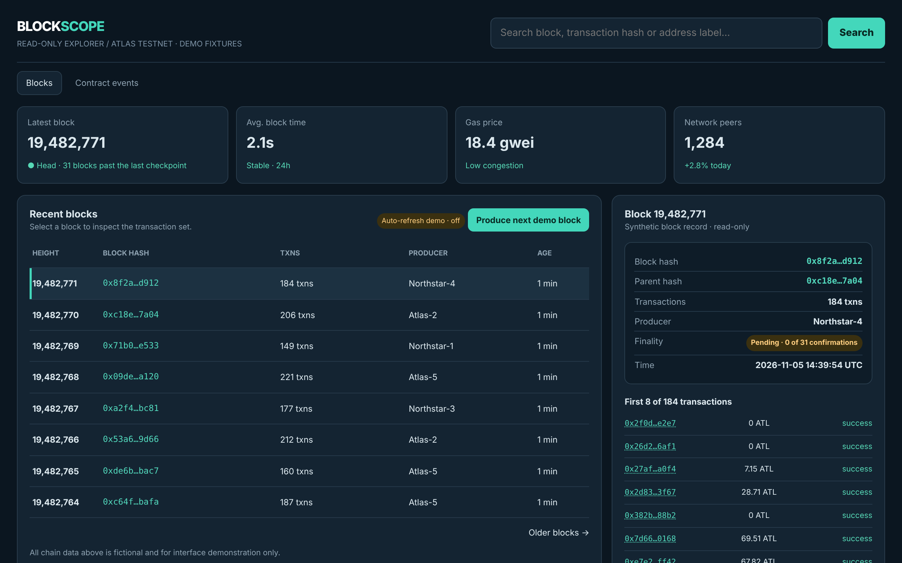

# Blockscope Explorer

Inspect blocks, transactions and contract activity.

An ACRYL Blends blueprint for the **Blockchain** category (`acrylblends.blockchain-blockscope`, category 72 of 100): a read-only blockchain explorer over a synthetic testnet with a block ledger and finality, search by height, hash or label, transaction pages with decoded event logs, address pages, contract events filtered by name and time range, and a saved watchlist.



## Who it is for

Developers, analysts and operators inspecting public chain activity.

## Start it

```sh
npm create acrylblends@latest my-blockchain -- --from acrylblends.blockchain-blockscope
cd my-blockchain
npm install
npm start      # the app on its own server; npm run dev opens it in the ACRYL frame
npm test       # domain and route tests
```

The first start seeds Atlas Testnet with its head at block 19,482,771 (the mockup's five blocks, hashes, producers and counts); every other block, transaction, address and event is generated from its height. State is saved as JSON in the app's data home (`.acrylblends/blockscope.json`); delete it to start over.

## What it does

| Screen | Path | What you can do |
| --- | --- | --- |
| Network strip | top | Latest block with its finality lag, average block time, gas price with its congestion, and peers. |
| Blocks | `/` | The recent block ledger (height, hash, transactions, producer, age), paged with `?before=`; the block inspector (`?block=`) with finality, parent hash and the first eight transactions. **Produce next demo block** moves the head; **Auto-refresh demo** (`?live=1`) re-renders every few seconds. |
| Search | header and inspector | Search by block height (commas allowed), a hash prefix or the short `0x8f2a…d912` form, an address, or an address label. |
| Transaction and address pages | `/tx/:hash`, `/address/:address` | Status, parties, value, gas and fee with decoded event logs and topics; an address's label, synthetic balance and recent transactions. |
| Contract events | `/events` | Decoded logs of the recent blocks filtered by event name and time range (1, 5 or 15 minutes of chain time), with the log topics of the demo contracts. |
| Watchlist | inspector | Watch a block, a transaction or an address; the list is saved. |

Blocks, transactions, addresses and events are generated from the height by a seeded generator, so a height is always the same block; only the first eight transactions of a block are generated, and searches scan the most recent blocks. A block is finalized once 31 blocks sit above it. A failed transaction records a revert reason and emits no events. Topics are demo values, not real hashes. The head and the watchlist (up to 20 items) are the only saved state.

## How it is made

Composed from Cordis plugins only; `blend.yaml` reads as what the app is made of:

| Row | Folder | Job |
| --- | --- | --- |
| `blockscope` | `plugins/blockscope/` | The domain (`ctx.chain`): the generator, search, events and the saved head and watchlist, as JSON in the app's data home. |
| `scope-shell` | `plugins/scope-shell/` | The shell (`ctx.scopeShell`): the header, tabs, network strip and inspector column; pages register a tab with `nav`, panels with `side`. |
| `network` | `plugins/network/` | The network strip, events and validators. |
| `blocks` | `plugins/blocks/` | The first page, the block inspector and the produce-block route. |
| `search`, `watchlist` | `plugins/<name>/` | Search results and the watchlist. |
| `transactions`, `addresses`, `contract-events` | `plugins/<name>/` | One page each. |

## Prototype boundaries

A read-only prototype over fictional data: there are no wallet actions, nothing is signed or sent, and no network or API is contacted. Every value is synthetic and labelled demo data.

## Ask the chat next

1. "Add a block detail page with a paginated, filterable list of all its transactions generated on demand from the seed."
2. "Add a time-range chart of transactions per block and gas price for the last 150 blocks, drawn as inline SVG."
3. "Add a decoded-input view for contract calls that shows the method arguments next to the raw call data."

Design: `design/spec.md` and `design/mockup.html`.
