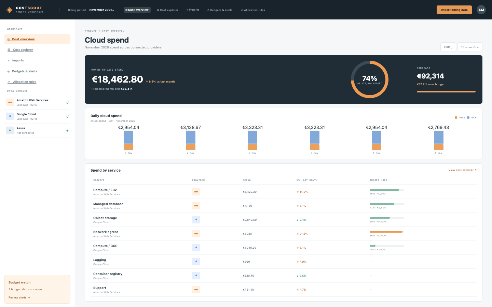

# Cloud Costs

A FinOps cost explorer: monthly spend per provider and service from CSV exports, with forecasts, budgets and alerts. The seed has AWS and Google Cloud connected, a November bill, five budgets and two alerts.

## Run it

```sh
npm install
npm start
```

Open the address it prints. `npm test` runs the tests (node:test; no network, no key).

## What to ask the chat next

- Import an Azure export after connecting it and see the new provider in the sidebar.
- Add a budget for object storage at €5,000 with an 80% alert.
- Add an allocation rule that gives network egress to the Network team.

## Screenshot


