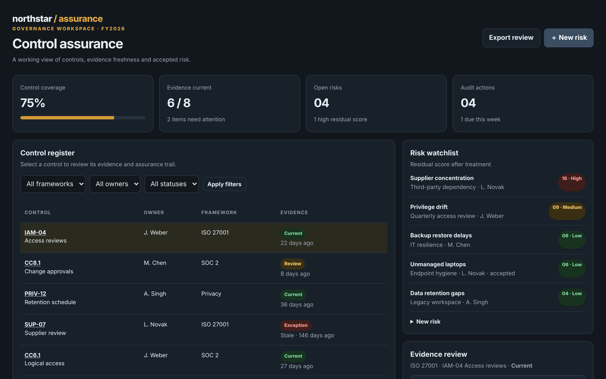

# Northstar GRC

Make controls, risks and evidence traceable.

An ACRYL Blends blueprint for the **Compliance and governance** category (`acrylblends.compliance-northstar-grc`, category 71 of 100): a governance workbench with a control register over three frameworks, evidence review (accept, request a refresh, mark an exception), a risk watchlist with treatments and a recalculating posture strip, audit actions and an exportable review.



## Who it is for

Compliance leads, internal auditors, risk owners and privacy or ESG teams.

## Start it

```sh
npm create acrylblends@latest my-compliance -- --from acrylblends.compliance-northstar-grc
cd my-compliance
npm install
npm start      # the app on its own server; npm run dev opens it in the ACRYL frame
npm test       # domain and route tests
```

The first start seeds FY2026 with eight synthetic controls (ISO 27001, SOC 2, Privacy) and their evidence, five risks and four open audit actions; the register opens on IAM-04 as in the mockup. State is saved as JSON in the app's data home (`.acrylblends/grc.json`); delete it to start over.

## What it does

| Screen | Path | What you can do |
| --- | --- | --- |
| Posture strip | top | Control coverage, evidence current, open risks (with high residual scores) and open audit actions (due this week), recalculated on every change. |
| Control register | `/` | Controls with owner, framework, status and evidence freshness; filter by framework, owner and status (`?framework=`, `?owner=`, `?status=`); open one (`?control=`). |
| Evidence review | right column | The control's evidence bundle (provenance, collection and review dates, retention class), **Accept evidence**, **Request refresh**, **Mark an exception** and the control's review history. |
| Risk watchlist | right column | Open risks by residual score and rating; the treatment form for the selected risk (`?risk=`) and the **＋ New risk** form (`?newrisk=1`). |
| Audit actions and Export review | right column and masthead | Open actions with their due date and **Mark done**; **Export review** downloads the review as Markdown. |

A control is Current when its newest evidence is accepted and was collected in the last 90 days, an Exception when one is marked (it needs a reason of at least 10 characters), otherwise Review. A risk score is likelihood × impact (1 to 5 each): High from 15, Medium from 8, otherwise Low. A treatment's residual likelihood and impact cannot exceed the inherent ones, a High residual risk cannot be accepted, accepting makes a risk accepted and avoiding closes it, so neither counts as open. Requesting a refresh opens an action due in a week; completing it brings the refreshed evidence in for review.

## How it is made

Composed from Cordis plugins only; `blend.yaml` reads as what the app is made of:

| Row | Folder | Job |
| --- | --- | --- |
| `grc` | `plugins/grc/` | The domain (`ctx.grc`): controls, evidence, risks, actions and the audit trail, saved as JSON in the app's data home. |
| `grc-shell` | `plugins/grc-shell/` | The shell (`ctx.grcShell`): the masthead, the posture strip, the register and the side column; parts are registered by other plugins. |
| `posture` | `plugins/posture/` | The posture strip. |
| `register` | `plugins/register/` | The first page, the control register. |
| `evidence`, `risks`, `actions`, `review-export` | `plugins/<name>/` | The evidence review, the risk watchlist and treatment, the audit actions and the export button. |

## Prototype boundaries

An illustrative control catalogue only: it does not claim certification or legal compliance, and holds no real personal data, sensitive evidence or audit findings. All controls and evidence are synthetic.

## Ask the chat next

1. "Add a control test: a scheduled test per control with a result history, and let a failed test move the control to Review."
2. "Add an evidence retention view that lists items by retention class and flags those past their retention date."
3. "Add a risk heat map (likelihood by impact) that updates when a treatment changes and links each cell to its risks."

Design: `design/spec.md` and `design/mockup.html`.
