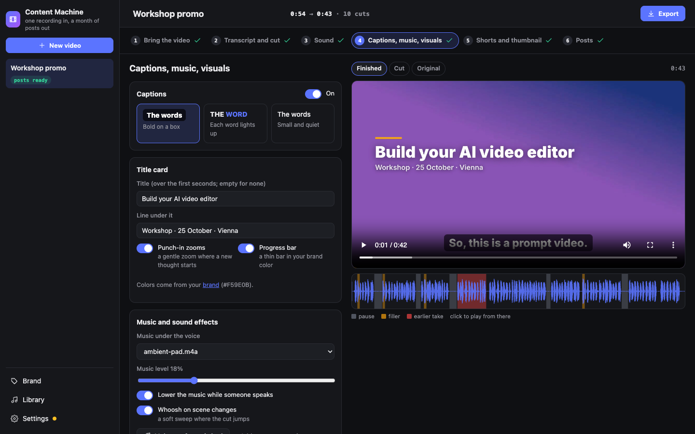
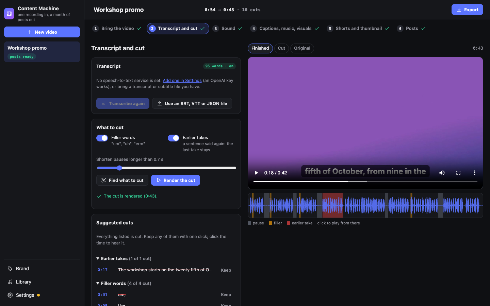
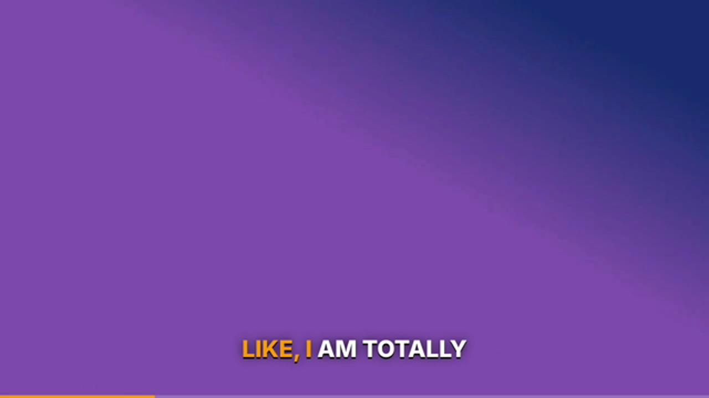
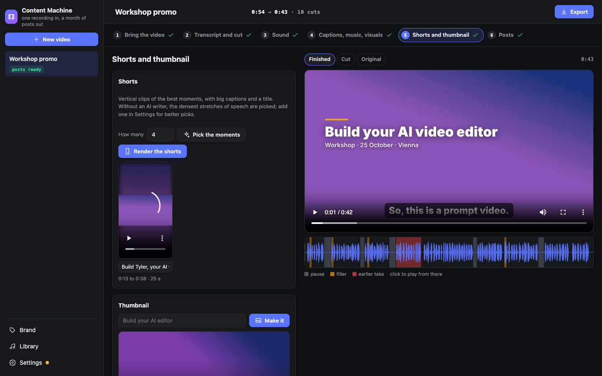
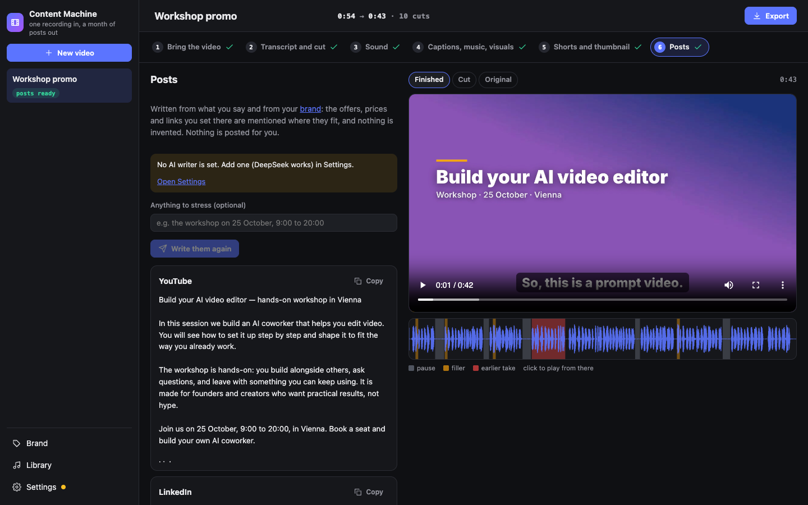
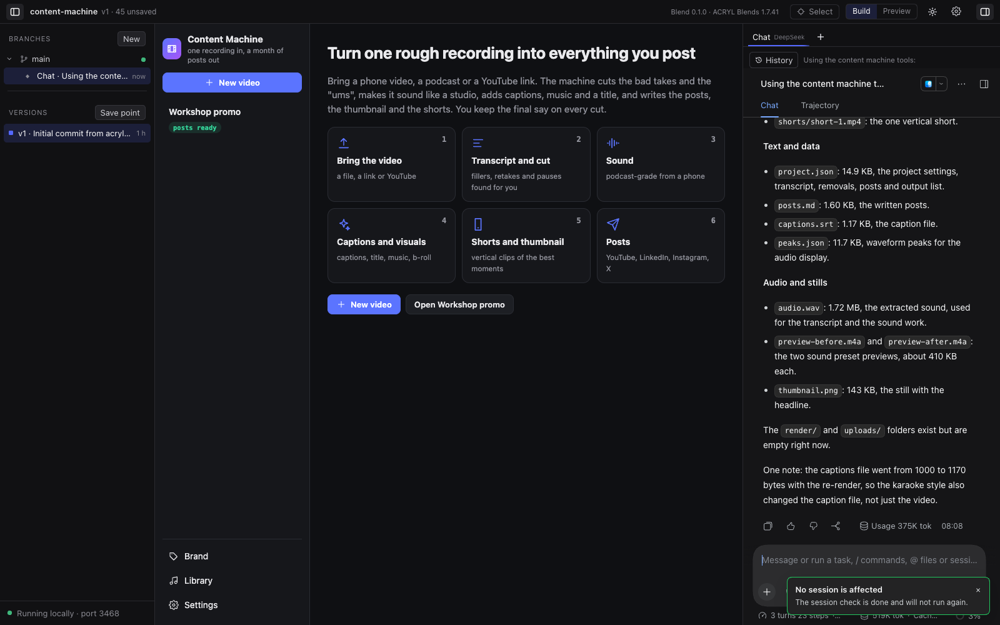

# ACRYL Content Machine

An all-in-one AI video editor and content formatter, as an ACRYL Blend: bring one rough recording (a phone video, a
podcast, a voice memo, a YouTube link) and get a finished video, vertical shorts, a thumbnail and the posts for YouTube,
LinkedIn, Instagram and X. You keep the final say on every cut, and the ACRYL agent can run every step for you.



| Transcript and cut | The finished video | Karaoke captions | Shorts and thumbnail |
|---|---|---|---|
|  |  |  |  |

| A vertical short | The thumbnail | Posts | The agent at work |
|---|---|---|---|
|  |  |  |  |

## The six steps

1. **Bring the video**: drop a file (MP4, MOV, WebM, MP3, WAV, M4A), or paste a link to one, or a YouTube (or similar)
   page (with yt-dlp installed). A sound-only recording gets a picture made from its sound wave.
2. **Transcript and cut**: the transcript, word by word, from a speech-to-text service (any OpenAI-compatible API) or
   from an SRT, VTT or JSON file you have. Then the cut: filler words ("um", "uh"), earlier takes of a sentence said
   again (the last take stays) and long pauses are found and listed; keep any of them with one click. The cut is
   rendered with a 10 ms fade at every join, so nothing clicks.
3. **Sound**: Clean or Podcast makes a phone recording sound like a studio (rumble and room noise away, the level
   evened, -16 LUFS for every platform). Hear 20 seconds before and after.
4. **Captions, music, visuals**: captions (bold on a box, karaoke, or minimal), a title card in your brand's color,
   punch-in zooms where a new thought starts, a progress bar, pictures and clips from your library over the video,
   a music bed that ducks while someone speaks, and a whoosh at scene changes. HyperFrames draws it all into the
   finished video; the captions are also saved as an SRT file.
5. **Shorts and thumbnail**: 2 to 10 vertical clips (1080x1920) of the moments that stand alone, with big captions and
   a title; a thumbnail with a telling frame and a headline of a few words.
6. **Posts**: a YouTube title, description and tags, a LinkedIn post, an Instagram caption and a post for X, written
   from what you say and from your brand (offers, prices and links are mentioned only as you wrote them). Nothing is
   posted for you.

**Brand** (what you do, for whom, your tone, offers, call to action, links, color), **Library** (music, sound effects,
pictures, clips) and **Settings** (the AI writer and speech to text) are pages of their own. Export downloads the
finished video, the cut, the captions, the thumbnail, the posts and every short.

**The agent**: the ACRYL chat on the right runs the same steps through ten typed tools (`content_*`): it lists and
reads projects, changes settings, keeps or cuts suggestions, sets the brand and runs any step (renders included),
and what it does shows on the screen at once.

## What it needs

- **ffmpeg** (and ffprobe) on the computer: `brew install ffmpeg`, `winget install ffmpeg`, or `apt install ffmpeg`.
  Settings shows whether it is found.
- **Chrome** (or Chromium): HyperFrames draws captions, titles, shorts and thumbnails with it.
- **An AI writer** for the posts, the shorts' picks and the thumbnail headline: any OpenAI-compatible chat API, set in
  Settings. DeepSeek works (`https://api.deepseek.com/v1`, `deepseek-chat`); `DEEPSEEK_API_KEY` in the environment is
  used when nothing is set. Without one, shorts are the densest stretches of speech.
- **Speech to text**, optional: any OpenAI-compatible `/audio/transcriptions` API (OpenAI's `whisper-1` gives word
  times), set in Settings, or `OPENAI_API_KEY`. Without one, bring a transcript or subtitle file.
- **yt-dlp**, optional, for YouTube and similar links.

Keys are kept in the app's data folder, readable by you only, never in the app's code. No model is downloaded.

Try it without a video of your own (macOS): `node scripts/make-sample.mjs` makes a messy sample recording (fillers, a
sentence said twice, long pauses) and its transcript in `.acrylblends/sample/`.

## Install

Make your own copy to change: `npx acryl new my-content-machine github:acrylblends/13-content-machine`.

Installers (from the latest release, <https://github.com/acrylblends/13-content-machine/releases/latest>):

| | Apple silicon / ARM | Intel / x64 |
|---|---|---|
| macOS | [ACRYL-Content-Machine-mac-arm64.dmg](https://github.com/acrylblends/13-content-machine/releases/latest/download/ACRYL-Content-Machine-mac-arm64.dmg) | [ACRYL-Content-Machine-mac-x64.dmg](https://github.com/acrylblends/13-content-machine/releases/latest/download/ACRYL-Content-Machine-mac-x64.dmg) |
| Windows | [ACRYL-Content-Machine-win-arm64.exe](https://github.com/acrylblends/13-content-machine/releases/latest/download/ACRYL-Content-Machine-win-arm64.exe) | [ACRYL-Content-Machine-win-x64.exe](https://github.com/acrylblends/13-content-machine/releases/latest/download/ACRYL-Content-Machine-win-x64.exe) |
| Linux (Debian, Ubuntu) | [ACRYL-Content-Machine-linux-arm64.deb](https://github.com/acrylblends/13-content-machine/releases/latest/download/ACRYL-Content-Machine-linux-arm64.deb) | [ACRYL-Content-Machine-linux-x64.deb](https://github.com/acrylblends/13-content-machine/releases/latest/download/ACRYL-Content-Machine-linux-x64.deb) |

Not signed yet: on macOS right-click the app and choose Open; on Windows, if SmartScreen asks, click More info and then
Run anyway.

## Develop

```sh
npm install
npm run dev            # the app in the ACRYL frame, with the agent on the right
npm start              # the app on its own server
npm test
npm run check          # type-check (server and screen)
npm run build:studio   # rebuild the screen after editing plugins/content-studio/client/src
```

Every feature is a Cordis plugin with its own row in `blend.yaml`; switching one off (Settings > Plugins) removes its
step from the screen and from the agent's tools:

| Plugin | What it does |
|---|---|
| `content` | the domain: projects (a folder each), the brand, the library, jobs, the feature registry and the sound chain |
| `content-ingest` | step 1: a file, a link or a YouTube page becomes `source.mp4`, `audio.wav` and the waveform |
| `content-transcribe` | the transcript: a speech-to-text API, or an SRT, VTT or JSON file |
| `content-cut` | fillers, earlier takes and pauses suggested; the cut rendered with the sound chain |
| `content-sound` | the voice cleaned (a stage of the sound chain), before and after |
| `content-music` | a ducked music bed and whooshes (a stage of the sound chain); a synthesized soft bed |
| `content-visuals` | captions, title card, b-roll, punch-ins, progress bar, drawn by HyperFrames |
| `content-shorts` | the best moments as vertical shorts |
| `content-thumbnail` | the thumbnail |
| `content-posts` | the posts, from the transcript and the brand |
| `content-api` | the JSON API, uploads, files with byte ranges, live events |
| `content-studio` | the screen (React, built into `client/dist`) |
| `content-tools` | the agent's `content_*` tools |

A new step is a new plugin: it injects `content` and registers a feature (`ctx.content.features.register(...)`) with
its actions; the screen, the API and the agent see it at once. `scripts/e2e.ts` runs every step on a real recording.

Built with HyperFrames (Apache-2.0) and GSAP; see NOTICE. MIT License.
