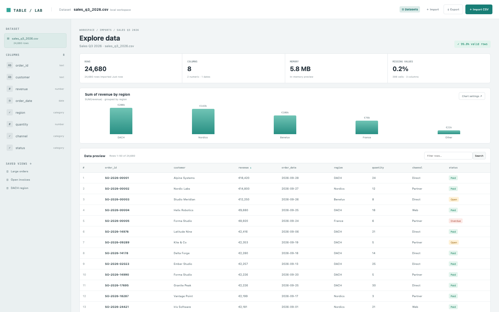

# CSV Explorer

A local-first data workbench: import a CSV, read its column profile, filter and sort the rows, chart a column and save views. The seed is a 24,680-row sales file, and the import reads a file from the disk or pasted text.

## Run it

```sh
npm install
npm start
```

Open the address it prints. `npm test` runs the tests (node:test; no network, no key).

## What to ask the chat next

- Import a second CSV from the Imports page and profile its missing values.
- Chart quantity by channel and save the view.
- Add a filter for the Nordics region and export the filtered rows as CSV.

## Screenshot


