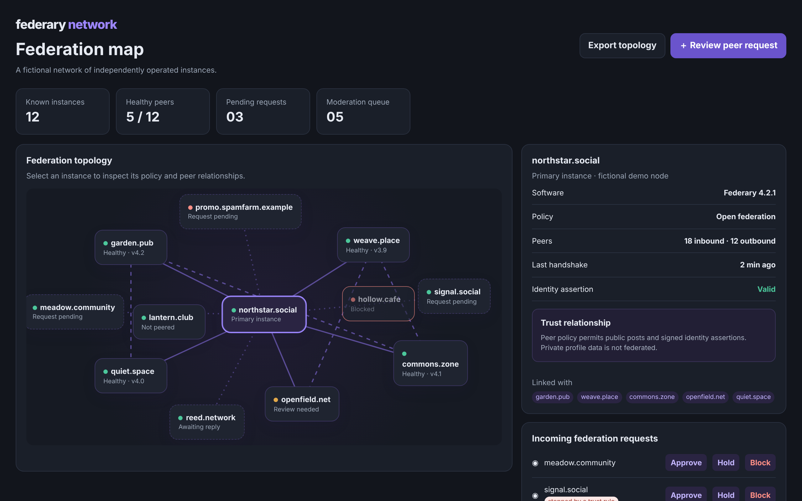

# Federary Network

See the shape and health of a federated network.

An ACRYL Blends blueprint for the **Decentralized software** category (`acrylblends.decentralized-federary`, category 73 of 100): a federation administration console with a topology map of fictional instances, an instance profile with policy and identity handshake, inbound and outbound federation requests, a moderation queue, trust rules that can stop an approval, and reversible recorded decisions.



## Who it is for

Operators of federated communities, decentralized services and self-hosted networks.

## Start it

```sh
npm create acrylblends@latest my-decentralized -- --from acrylblends.decentralized-federary
cd my-decentralized
npm install
npm start      # the app on its own server; npm run dev opens it in the ACRYL frame
npm test       # domain and route tests
```

The first start seeds northstar.social with twelve fictional instances: five peers (one needing review), three inbound requests, one outbound request, a blocked instance, an instance with an expired identity assertion, five content reports and three trust rules. State is saved as JSON in the app's data home (`.acrylblends/federary.json`); delete it to start over.

## What it does

| Screen | Path | What you can do |
| --- | --- | --- |
| Stats | top | Known instances, healthy peers, pending requests and the moderation queue, recalculated on every decision. |
| Federation topology | `/` | The instance cards and trust edges: solid for peers, amber for quarantined, dotted for pending, dashed between peers; a blocked instance loses its links. Pick an instance (`?instance=`). |
| Instance profile | right column | Software, policy, peers, last handshake and identity assertion; the actions the relation allows (Approve, Quarantine, Block, Unblock, Withdraw, Request peering) and **Run handshake**. |
| Federation requests | right column and top bar | Approve, hold or block each inbound request; withdraw an outbound one. **＋ Review peer request** jumps to the first inbound request. |
| Moderation, trust rules and history | right column | Open content reports (dismiss, limit or block the instance), the trust rules with on and off, and the recorded decisions with **Undo**. **Export topology** downloads the map as JSON. |

Relation changes follow a fixed table (for example approve works from a pending request or a quarantine, block from any relation but blocked). Approving is stopped by a trust rule: a deny rule that matches the domain, an expired identity assertion, or an unsigned one while the signed-identity rule is on. A decision is recorded with the state before and after and can be undone only while the instance still has the result it produced. A handshake fails for an expired assertion; a valid one clears a review.

## How it is made

Composed from Cordis plugins only; `blend.yaml` reads as what the app is made of:

| Row | Folder | Job |
| --- | --- | --- |
| `federary` | `plugins/federary/` | The domain (`ctx.fed`): instances, links, reports, trust rules, decisions and events, saved as JSON in the app's data home. |
| `fed-shell` | `plugins/fed-shell/` | The shell (`ctx.fedShell`): the masthead, the stats strip, the topology and the side column; parts are registered by other plugins. |
| `stats`, `topology` | `plugins/<name>/` | The stats strip and the first page, the map. |
| `profile`, `queue`, `moderation`, `trust`, `history` | `plugins/<name>/` | The side column, one panel each. |
| `topology-export` | `plugins/topology-export/` | The Export topology button and its download route. |

## Prototype boundaries

Nothing federates: every instance is fictional, no message leaves the app, and no real identity assertion is checked. Moderation decisions are reversible demo actions recorded in local history.

## Ask the chat next

1. "Add a federation policy editor for the primary instance with a preview of which current peers each change would affect."
2. "Add a peer comparison view that lines up two instances' policies, handshake times and shared peers."
3. "Add a block list import that parses a plain-text list of domains, shows what it would block, and applies it as one undoable decision."

Design: `design/spec.md` and `design/mockup.html`.
