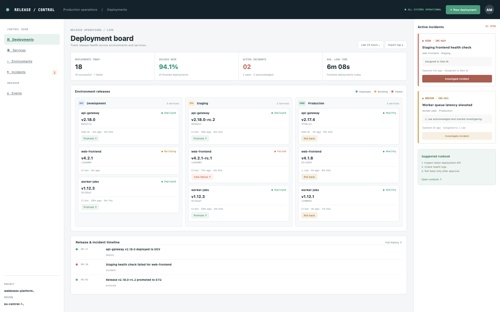

# Deploy Board

A release operations console: deployments per service and environment, a chronological event feed and an incident board with a timeline. The seed has three services, three environments and eighteen deployments today.

## Run it

```sh
npm install
npm start
```

Open the address it prints. `npm test` runs the tests (node:test; no network, no key).

## What to ask the chat next

- Queue a deployment of the worker to staging and promote it.
- Roll back the production gateway and look at the event log.
- Acknowledge the staging incident and resolve it after the rollback.

## Screenshot


