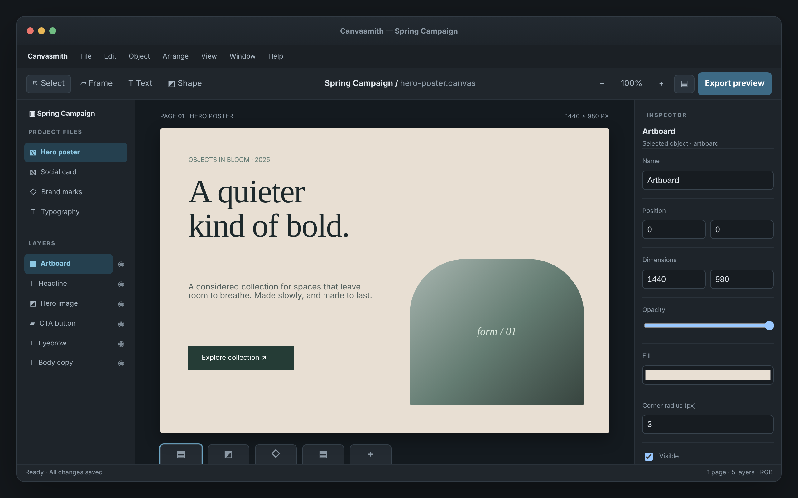

# Canvasmith Desktop

A focused desktop workspace for building and organizing visual assets.

An ACRYL Blends blueprint for the **Desktop** category (`acrylblends.desktop-canvasmith`, category 63 of 100): a desktop-style design workspace: project files, an artboard drawn from layers at a chosen zoom, an inspector with checked property edits, layer ordering, tools that add layers, and simulated exports with an activity log.



## Who it is for

Designers, desktop-product teams and developers exploring native, Electron or Tauri application UX.

## Start it

```sh
npm create acrylblends@latest my-canvas -- --from acrylblends.desktop-canvasmith
cd my-canvas
npm install
npm start      # the app on its own server; npm run dev opens it in the ACRYL frame
npm test       # domain and route tests
```

The first start seeds the Spring Campaign project with four files (Hero poster is open: a 1440 × 980 artboard and five objects on it), 100% zoom and the Select tool. State is saved as JSON in the app's data home (`.acrylblends/canvasmith.json`); delete it to start over.

## What it does

| Screen | Path | What you can do |
| --- | --- | --- |
| Project sidebar | left | The files (`?file=`) and the open file's layers (`?layer=`); the eye button hides or shows a layer, and the toolbar's layer-list button hides the list. |
| Canvas | `/` | The artboard drawn from the layers at 70–130% zoom (`−`, `100%`, `+`), with the selected layer outlined. The Frame, Text and Shape tools each add a layer; **+ New** in the asset strip creates an empty artboard. |
| Inspector | right | The selected layer's name, position, size, opacity, fill, corner radius, visibility and text; **Apply** saves them. **Bring forward**, **Send backward** and **Delete layer** arrange it. |
| Export and activity | right, below | **Export preview** (PNG, JPG or SVG at 1x or 2x) records a simulated export with its file name, pixel size and estimated size; the activity list shows what happened. |

Every property edit is checked: whole numbers in range (width and height at least 1), a `#rrggbb` fill, a name of 1–40 characters, text up to 300. The artboard is the page: it stays at the origin and at the back and cannot be deleted. An export is refused when nothing visible would be drawn. A file holds at most 40 layers and a project 12 files. Changes are saved as you make them.

## How it is made

Composed from Cordis plugins only; `blend.yaml` reads as what the app is made of:

| Row | Folder | Job |
| --- | --- | --- |
| `canvasmith` | `plugins/canvasmith/` | The domain (`ctx.project`): files and layers, property checks, z-order, zoom, exports and the activity log, persistence behind a store port. |
| `window-shell` | `plugins/window-shell/` | The window shell (`ctx.windowShell`): title bar, menu bar, toolbar, status bar, the three regions and the mockup's styles. |
| `files`, `inspector`, `exports` | `plugins/<name>/` | The sidebar and the inspector's two parts. |
| `canvas` | `plugins/canvas/` | The first page and the toolbar's tools and zoom. |

## Prototype boundaries

The menu bar is a demo-only decoration. Nothing is written to disk but the project's own JSON; an export is a record of what would be produced.

## Ask the chat next

1. "Add drag-to-move on the canvas: let me pick a layer and nudge it with the arrow keys by 1 px, or 10 px with Shift, saving each move."
2. "Add an undo and redo history for property edits, with the last twenty changes listed in the activity panel."
3. "Add a Social preset: a new-file dialog with Hero poster, Social card and Story sizes, creating an artboard of that size with a headline layer."

Design: `design/spec.md` and `design/mockup.html`.
