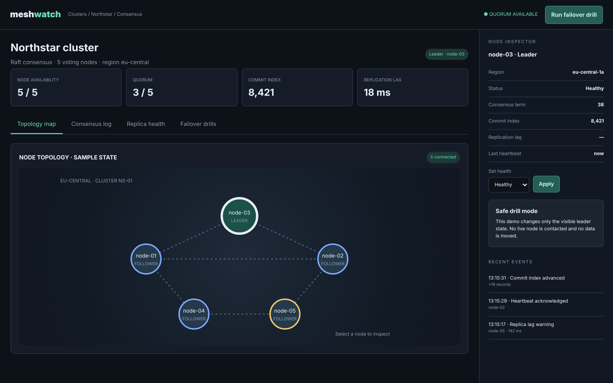

# Meshwatch

Understand cluster topology, quorum and replica health.

An ACRYL Blends blueprint for the **Distributed Systems** category (`acrylblends.distributed-meshwatch`, category 55 of 100): a Raft cluster's
topology map, node health, quorum, an append-only commit log, replica lag and failover drills that move the leader.



## Who it is for

Distributed-systems engineers, SREs, database operators and platform teams.

## Start it

```sh
npm create acrylblends@latest my-mesh -- --from acrylblends.distributed-meshwatch
cd my-mesh
npm install
npm start      # the app on its own server; npm run dev opens it in the ACRYL frame
npm test       # domain and route tests
```

The first start seeds Northstar: five voting nodes in eu-central, node-03 leading term 38, commit index 8,421, one degraded follower (node-05), the
newest commit-log entries, recent events and two past drills. State is saved as JSON in the app's data home (`.acrylblends/meshwatch.json`).

## What it does

| Screen | Path | What you can do |
| --- | --- | --- |
| Topology map | `/` | The nodes and links on a map: the leader in mint, degraded nodes in yellow, down nodes dashed. Click a node to inspect it (`?node=`). |
| Consensus log | `/consensus` | The append-only commit log, newest first: index, term, origin, event and whether it committed. |
| Replica health | `/replicas` | Every node's role, status, lag and last heartbeat. |
| Failover drills | `/drills` | Run a failover (to the best follower or one you pick), a quorum test, or **Reset fixture**; the history lists every drill. |

The right column is the node inspector: role, region, term, commit index, lag and heartbeat, and **Set health** to rehearse a failure. Quorum is a
majority of the voting nodes (3 of 5). Taking the leader down elects the best healthy follower in a new term while a quorum remains; below a quorum
the cluster is leaderless and its log entries stay uncommitted until enough nodes return, which triggers the election.

## How it is made

Composed from Cordis plugins only; `blend.yaml` reads as what the app is made of:

| Row | Folder | Job |
| --- | --- | --- |
| `meshwatch` | `plugins/meshwatch/` | The domain (`ctx.mesh`): nodes, leader and term, quorum, election, the commit log, events, drills, persistence behind a store port. |
| `mesh-shell` | `plugins/mesh-shell/` | The page shell (`ctx.meshShell`): top bar, heading, statistics, tabs and the mockup's styles. |
| `inspector` | `plugins/inspector/` | The right column. |
| `topology`, `consensus`, `replicas`, `drills` | `plugins/<name>/` | One plugin per tab, each registering its tab so it leaves with the plugin. |

## Prototype boundaries

The cluster is a fixture. No node is contacted, no data moves, and the lag and heartbeat numbers are illustrative.

## Ask the chat next

1. "Add a partition simulator: split the cluster into two groups, show which side keeps the quorum, and log what each side can commit."
2. "Make the commit log tail itself: append a heartbeat entry every few seconds through server-sent events while a leader exists."
3. "Add a membership change drill: add a sixth node, show the new quorum size, and refuse to remove a node when that would break the quorum."

Design: `design/spec.md` and `design/mockup.html`.
