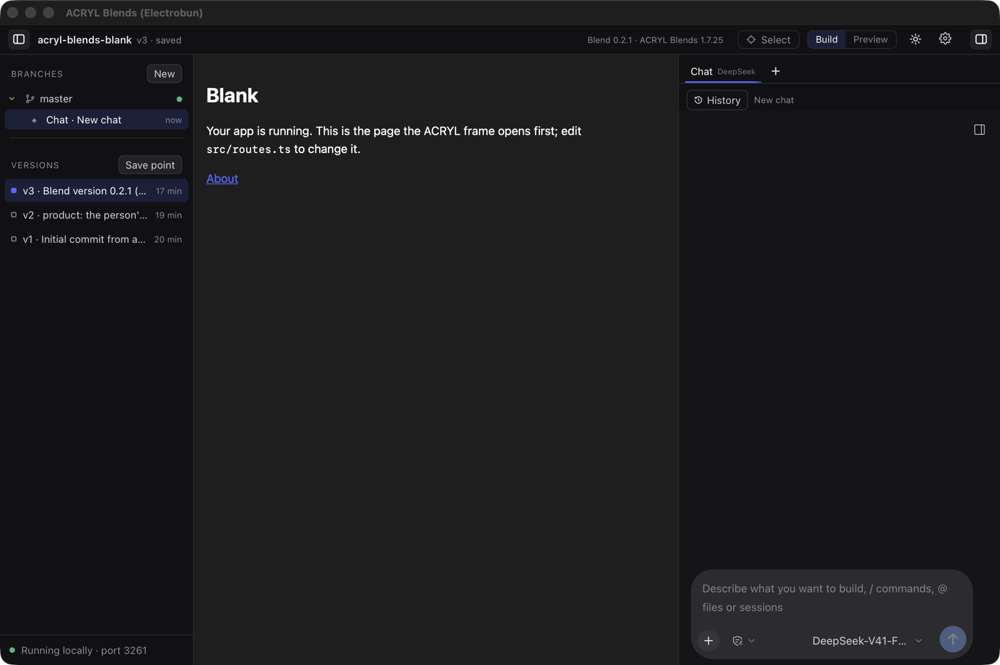

# ACRYL Blends on Electrobun

The ACRYL Blends Blank app (the app `npx @acryldev/create-blends@latest` makes: the frame with sessions and versions on the left, the app in the
middle, chat and the agents on the right) as an installable desktop app on **Electrobun** instead of Electron. Same app, same Program, same data
folder (`~/.acryl/apps/<id>`). Since 0.2.2 the frame host runs on Electrobun's own Bun: no Chromium and no Node in the bundle. Since 0.2.3 the bundle is trimmed for
Bun, the terminals work on Bun, and an agent's live changes (a new plugin, an edit) are served in place.



The same release on [Windows](docs/screenshot-windows.png) and [Linux](docs/screenshot-linux.png).

## Download

From the [Latest release](https://github.com/acrylblends/63-electrobun-blank/releases/latest):

| OS | Electrobun build | Electron build of the same app (for comparison) |
| --- | --- | --- |
| macOS (Apple silicon) | `ACRYL-Blends-Electrobun-mac-arm64.dmg` | `ACRYL-Blends-Electron-mac-arm64.dmg` |
| Windows x64 / arm64 | `ACRYL-Blends-Electrobun-win-<x64/arm64>-Setup.zip` (unzip, run the Setup) | `ACRYL-Blends-Electron-win-<x64/arm64>.exe` |
| Linux x64 / arm64 | `ACRYL-Blends-Electrobun-linux-<x64/arm64>-Setup.tar.gz` (unpack, run `installer`) | `ACRYL-Blends-Electron-linux-<x64/arm64>.deb` |

Not signed. macOS: right-click the app and choose Open. Windows: if SmartScreen asks, click More info and then Run anyway. The first start
unpacks the app (macOS about 17 s and a small Setup window to close; Linux about 30 s; Windows about 8 minutes with Defender scanning each file,
and the Setup does not start the app: start it from the Start menu).

## Sizes (release v0.2.3, both builds from the same run)

| OS | Electron download | Electrobun download | Electron installed | Electrobun installed |
| --- | ---: | ---: | ---: | ---: |
| macOS arm64 | 205.2 MB | **70.8 MB (-65%)** | 547.9 MB | **263.4 MB (-52%)** |
| Windows x64 | 177.1 MB | **81.4 MB (-54%)** | 598.2 MB | **289.7 MB (-52%)** |
| Windows arm64 | 171.4 MB | **76.1 MB (-56%)** | 599.1 MB | **275.9 MB (-54%)** |
| Linux x64 | 142.5 MB | **84.7 MB (-41%)** | 503.8 MB | **303.8 MB (-40%)** |
| Linux arm64 | 136.8 MB | **83.0 MB (-39%)** | 507.8 MB | **301.0 MB (-41%)** |

Installed = the unpacked app, sum of file sizes (MB = 1,000,000 bytes); `sizes-<os>-<arch>.json` in the release has the parts (shell, app, Git).
Since 0.2.3 the app part is 47 MB smaller than in the Electron build: on Bun, for one OS and CPU, `electrobun/slim.mjs` leaves out what never runs
there (packages only Electron or a TypeScript build uses, type declarations, source maps, C/C++ sources of native modules, other OSes' native
builds, third-party docs; Bun compiles TypeScript itself), and Git keeps only the commands ACRYL runs.

## Live changes on Bun

An agent in the right panel (or you, in an editor) adds a plugin (`plugins/<name>/index.ts` plus its row in `blend.yaml`) or edits the app's
code while it runs: the frame loads the change inside the running host, the plugin is served within 2 s, and the agent's terminal stays open.
The host is started again only after it crashed, on the next saved change (`electrobun/run-host.mjs`; the Electron build restarts its host on
every change, which closes the terminals). A new plugin may import the framework by name (`import { Acryl } from 'acrylblends'`).
Tested from the release builds on macOS arm64, Windows 10 x64 and Ubuntu 24.04 x64.

Electrobun also keeps an uninstaller outside the app folder (`~/Library/Application Support/<id>`, `~/.local/share/<id>`,
`%LOCALAPPDATA%\<id>`); the 38 MB `self-extraction` list it leaves there is removed on the first start.

## How it works

- `electrobun/main.ts` is Electrobun's main process (Bun). It does for the packed product what `@acryldev/desktop-shell`'s Electron main does,
  with the same steps (`electrobun/shell-core.mjs` is a copy of them): open the product's app in `~/.acryl` (on the first start, make it from
  the bundled Blank app), start the frame host, open one window (the system webview: WKWebView on macOS, WebView2 on Windows, WebKitGTK on
  Linux) on the address it prints, and stop the host when the window closes or the app quits.
- The frame host on Bun: Bun has no `node:module` `registerHooks`, which ACRYL uses to serve the Program (the framework's plugins and packages)
  from the bundle. Instead the Program is linked into the app's source (`node_modules`, `app/`, `frame/`, `scripts/`, the library plugins,
  kept out of `git status` through `.git/info/exclude`), and `electrobun/bun-node-hooks.mjs` gives the four files that import `registerHooks` a
  stand-in. Bun compiles the app's `.tsx` itself (`Bun.Transpiler` also compiles the frame's client modules, so `typescript` does not ship), and
  the framework's names in the app's own files (`acrylblends`, `acrylblends/<sub>`) are mapped to the app's copy as they load.
  `--no-install` keeps Bun from fetching a missing package from its own cache.
- Terminals: on macOS and Linux `node_modules/node-pty` is `electrobun/bun-pty.cjs`, node-pty's API on `Bun.spawn({ terminal })` (node-pty's
  output never arrives on Bun there); Windows keeps node-pty (ConPTY), which works on Bun.
- `electrobun/run-host.mjs` runs the host in place of the Electron shell's watcher: no restart on an edit (the frame loads it in place), a
  start again after a crash on the next saved change, and `main.ts` then reloads the window.
- `electrobun/pack.mjs` packs both: `npx @acryldev/blends pack` (the official Electron product), then an Electrobun bundle from the same files.
  `--host node` builds the 0.2.0 variant (Node in the bundle). `.github/workflows/release.yml` runs it on every OS; a tag `v<version>` publishes.

```sh
npm run pack:electrobun    # this machine's OS and CPU; writes dist/release
```

Hutch (Electrobun's build tool, downloaded on first use into `~/.hutch`) may add a PATH line to your shell profile. Run it in CI or check
`~/.zshrc` afterwards.

## Not the same as the Electron build yet

- No updater (Electrobun has its own update channel; ACRYL's GitHub-release updater is Electron code), no door window calls
  (`acryl window ...`), no Settings > App pages that need the Electron preload.
- The window's process is named `bun`; the Dock shows the app's name and icon. On Windows the menu bar shows Edit and Window only.
- No Intel Mac build: Electrobun's DMG step fails on the Intel runner.
- Linux: the app canvas renders light in WebKitGTK where the other two show it dark.

## The app itself

A Cordis app on Node, scaffolded by `acrylblends init`. TypeScript, run by Node with no build step. Every part is a
Cordis plugin.

```sh
npm install
npm run dev        # prints its URL; data lives in ~/.acryl/apps/<id>/data/
npm test
npm run check      # type-check
```

- `src/main.ts` chooses where the app lives (the `@acryldev/instance` package) and starts it.
- `blend.yaml` is the app as data: which plugins it mounts, in what order, with what config and parameters. Switch
  one off with `disabled: true`. `npm run lock` writes `blend.lock.json`: the manifest's digest and a digest of
  every plugin folder, so a diff of the lock shows what changed.
- `src/app.ts` holds the registry of plugins the code provides, and mounts the manifest's rows.
- `src/routes.ts` is your own plugin: it builds an `App` (`import { App } from './plugins/router/src/index.ts'`) and mounts it with `ctx.router.route(prefix, app)`. Routes added to the app after it is mounted are not served. A page mounted at `/x` answers `/x`, not `/x/` (trailing slashes are strict). The router API is documented at https://acrylblends.github.io/docs/framework/the-acryl-framework and in `docs/framework` of the acrylblends repository.
- `plugins/` holds the plugins copied from the ACRYLBLENDS library. They are yours now; edit them freely.
  Add more with `acrylblends add <plugin>`.

`npm run save -- "message"` commits the app with git (and pushes when it has a remote). It refuses a file that looks like
it holds a secret, and refuses to push a private app (anything but `visibility: public` in `blend.yaml`) to a public
remote.

Set `ACRYLBLENDS_HOME` to keep data elsewhere, and `ACRYLBLENDS_PORT` to choose the first port tried.
