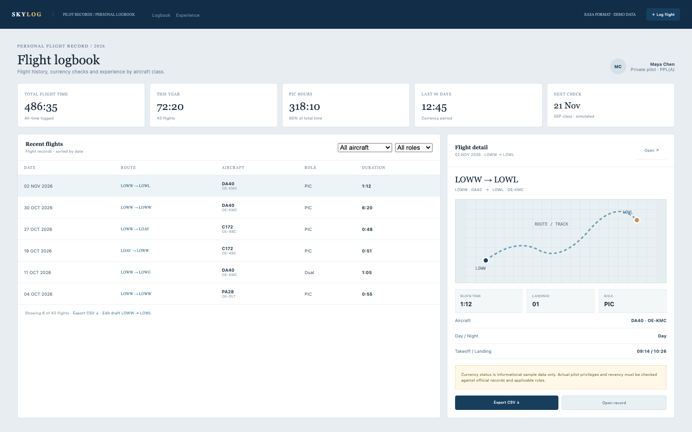

# Flight Logbook

A pilot logbook: 486:35 total time, 72:20 this year across 43 flights, 318:10 PIC, 12:45 in the last 90 days, the six most recent flights, route detail, an experience summary by aircraft class, role and day/night, and a CSV export. Sample data and informational currency labels only; nothing here certifies legal privileges.

## Run it

```sh
npm install
npm start
```

Open the address it prints (the app keeps its data in `.acryl/`). `npm test` runs the suite with `node:test`; it needs no port and no credentials. The tests pin `TZ=UTC` and also pass under America/Los_Angeles and Asia/Tokyo.

## What is here

- **Logbook** (`/`): the pilot summary, the five hour totals, the aircraft and role filters, the six recent logged flights and the selected flight's route card.
- **Flight detail** (`/flights/:id`): aerodromes, aircraft type/registration, date, takeoff and landing times, duration, role, landings and remarks.
- **Log flight** (`/flights/new`) and **draft edit** (`/flights/:id/edit`): the validated form, and the one draft record that can be completed and logged.
- **Experience** (`/experience`): hours by SEP/MEP class, role, day/night and period.
- **Export** (`/export.csv`): every logged and draft record.

Every screen is its own Cordis plugin in `plugins/`, with a row in `blend.yaml` and a `plugin.json`; Settings > Plugins switches any of them off.

## Notes on the design

The seed produces the mockup's totals exactly: the six named flights, 36 generated flights and a night-currency flight make 43 logged flights and 72:20 this year; 40 historical flights bring the all-time total to 486:35; the opening PIC minutes fill the gap to 318:10; the named flights plus the currency flight make 12:45 in the last 90 days. Currency dates are labelled simulated and informational.

The boundaries follow the engineering books: `plugins/logbook` is pure domain code with an injected `Store`, `clock` and `newId` (Clean Architecture's dependency rule; DDD Distilled's flight, aircraft and endorsement language), and each screen is its own plugin (A Philosophy of Software Design).

## What to ask the chat next

- Log a 1:10 flight from LOWW to LOWL in OE-KMC and check the year total.
- Filter the table to the C172 and explain the aircraft column.
- Complete the draft flight and export the CSV, then find its row.

## Screenshot


