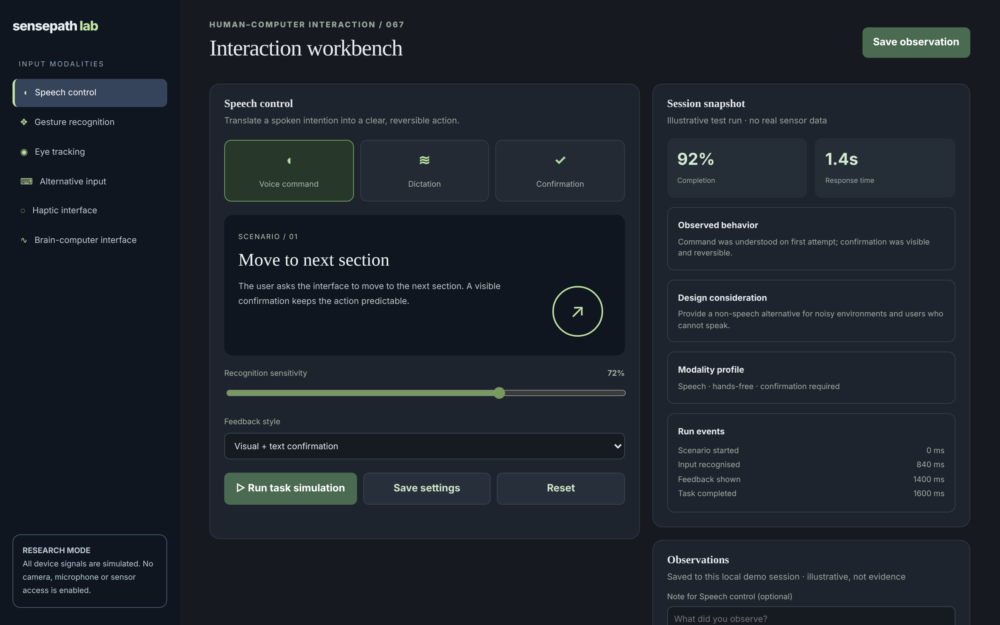

# Sensepath Lab

Prototype the interface between human intent and machine response.

An ACRYL Blends blueprint for the **Human-computer interaction** category (`acrylblends.hci-sensepath-lab`, category 67 of 100): an interaction research workbench with six simulated input modalities, a scenario and calibration for each, a deterministic task simulation with synthetic timing events, and saved observations that can be compared.



## Who it is for

HCI researchers, product designers, accessibility practitioners and prototyping teams.

## Start it

```sh
npm create acrylblends@latest my-hci -- --from acrylblends.hci-sensepath-lab
cd my-hci
npm install
npm start      # the app on its own server; npm run dev opens it in the ACRYL frame
npm test       # domain and route tests
```

The first start seeds all six modalities at the default calibration (72% sensitivity, visual + text feedback) and two earlier runs saved as observations, speech (92%, 1.4 s) and gesture (88%, 1.1 s). State is saved as JSON in the app's data home (`.acrylblends/sensepath.json`); delete it to start over.

## What it does

| Screen | Path | What you can do |
| --- | --- | --- |
| Input modalities | left rail | Speech control, Gesture recognition, Eye tracking, Alternative input, Haptic interface and Brain-computer interface (`?modality=`). |
| Workbench | `/` | The modality's three variants, its scenario stage, the calibration (recognition sensitivity and feedback style) and **Run task simulation**, **Save settings** and **Reset**. |
| Session snapshot | right column | Completion and response time of the latest run (the illustrative baseline before a run), the observed behaviour, the design consideration, the modality profile and the run's synthetic events. |
| Observations | header and right column | **Save observation** keeps the latest run with an optional note; saved observations can be deleted and any two compared (completion and response time deltas and the settings that differ). |

Sensitivity is a whole number from 10 to 100%. At the default 72% every modality reproduces its illustrative figure; lower sensitivity misses more (completion falls twice as fast per point and the response is slower), higher sensitivity triggers by accident (completion falls slowly, the response is faster). Text-only feedback, a haptic cue, and variants add small fixed offsets. A run below 75% completion is missed and shown as an error. An observation needs a run, each run can be saved once, and at most 20 observations are kept.

## How it is made

Composed from Cordis plugins only; `blend.yaml` reads as what the app is made of:

| Row | Folder | Job |
| --- | --- | --- |
| `sensepath` | `plugins/sensepath/` | The domain (`ctx.lab`): modalities, calibrations, the simulation, runs and observations, saved as JSON in the app's data home. |
| `sense-shell` | `plugins/sense-shell/` | The shell (`ctx.senseShell`): the rail, the header and the two columns; side parts are registered by other plugins. |
| `modalities` | `plugins/modalities/` | The rail. |
| `workbench` | `plugins/workbench/` | The first page and the variant, calibration, run and reset routes. |
| `snapshot`, `observations` | `plugins/<name>/` | The right column and the header's Save observation. |

## Prototype boundaries

All modality activity is simulated. No microphone, camera, eye tracker, brain-computer interface, haptic device or biometric input is accessed, and the sample metrics are illustrative: they are not clinical or scientific evidence.

## Ask the chat next

1. "Add a participant-free study plan: a list of scenarios run in order with fixed calibrations, and a summary table of the synthetic results."
2. "Add an accessibility checklist per modality (alternatives, timing, error recovery) that scores a saved observation."
3. "Export the saved observations and their comparisons as CSV, with the calibration columns, from a plugin."

Design: `design/spec.md` and `design/mockup.html`.
