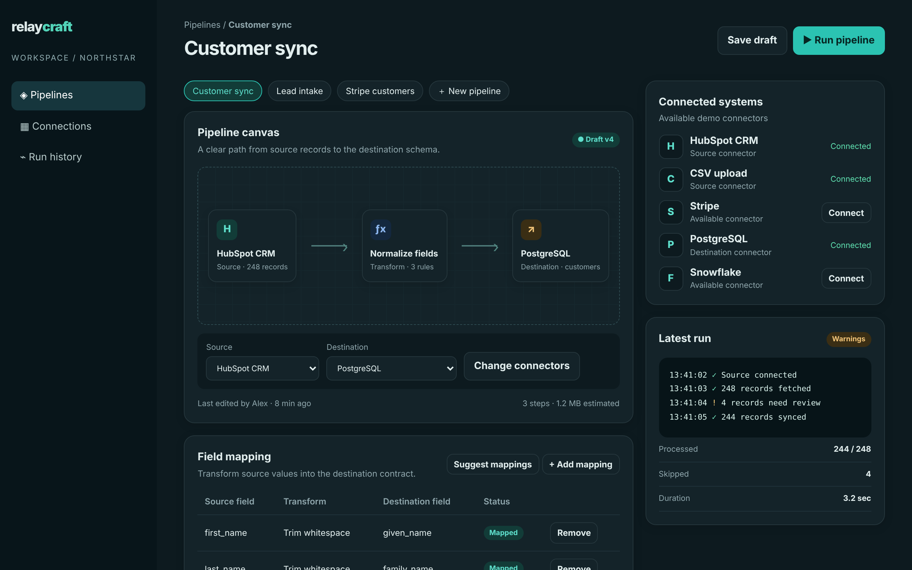

# Relaycraft

Move business data across systems, with every transformation visible.

An ACRYL Blends blueprint for the **Integration** category (`acrylblends.integration-relaycraft`, category 61 of 100): an integration studio with connectors and connections, a pipeline canvas of source, transform and destination, field mappings with a sample-record preview, and a deterministic sync simulation with run history.



## Who it is for

Operations engineers, integration specialists and teams connecting business systems.

## Start it

```sh
npm create acrylblends@latest my-integrations -- --from acrylblends.integration-relaycraft
cd my-integrations
npm install
npm start      # the app on its own server; npm run dev opens it in the ACRYL frame
npm test       # domain and route tests
```

The first start seeds five demo connectors (HubSpot CRM, a CSV upload, Stripe, PostgreSQL, Snowflake), three pipelines (Customer sync is open) and its latest run: 248 rows fetched, 244 synced, 4 skipped. State is saved as JSON in the app's data home (`.acrylblends/relaycraft.json`); delete it to start over.

## What it does

| Screen | Path | What you can do |
| --- | --- | --- |
| Pipelines | `/` | Pick a pipeline (`?pipeline=`) or make a **New pipeline** between two connected connectors. The canvas shows source, transform and destination; **Change connectors** swaps them and suggests mappings. Field mappings are added, removed or suggested, each with a status (Mapped, or Review when the sample rows hold padding or empty values and no transform is chosen); a preview shows the first rows as the destination receives them and the unmapped source fields. **Save draft** bumps the version. |
| Connections | `/connections` and a right-column card | Every connector with its fields and credential *reference* (never a secret); **Connect** and **Disconnect**, which is refused while a pipeline uses the connector. |
| Run history | `/runs` and the Latest run card | **Run pipeline** runs the source's sample rows through the mappings. The page lists every run with its counts and the rows that were skipped or failed. |

A run is refused until the destination's required fields are mapped. An invalid e-mail skips the row; a value a transform cannot format (an E.164 phone number with fewer than seven digits) fails it; the rest are synced. The sample rows are generated deterministically, so the same pipeline always gives the same run. A transform must suit the destination field's type.

## How it is made

Composed from Cordis plugins only; `blend.yaml` reads as what the app is made of:

| Row | Folder | Job |
| --- | --- | --- |
| `relaycraft` | `plugins/relaycraft/` | The domain (`ctx.studio`): connectors, pipelines and mappings, sample records, the sync simulation, persistence behind a store port. |
| `craft-shell` | `plugins/craft-shell/` | The page shell (`ctx.craftShell`): the rail, title, actions, right column and the mockup's styles. |
| `pipelines` | `plugins/pipelines/` | The first page. |
| `connections`, `runs` | `plugins/<name>/` | A page and a right-column card each, registering their rail entry so it leaves with the plugin. |

## Prototype boundaries

No real system is contacted; a connection stores only a credential reference, and all data are generated samples.

## Ask the chat next

1. "Add a second transform step type, "Filter rows", with a condition on a source field, and show how many rows it drops in the preview and the run."
2. "Add a schedule to each pipeline (hourly, daily, manual) and a next-run time, and let me run all due pipelines at once."
3. "Add a data contract page: define the destination's fields, types and required flags, and check every pipeline against it."

Design: `design/spec.md` and `design/mockup.html`.
