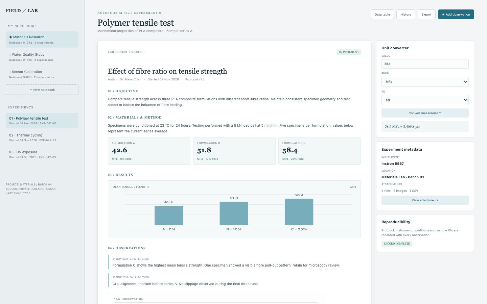

# Lab Notebook

A research notebook for reproducible experiments: three notebooks, 23 experiments, and an append-only record with objectives, protocols, sample-level measurements, series averages, a chart, timestamped observations, attachments, an audit trail and a unit converter. The sample values are illustrative and the conversions are exact.

## Run it

```sh
npm install
npm start
```

Open the address it prints (the app keeps its data in `.acryl/`). `npm test` runs the suite with `node:test`; it needs no port and no credentials. The tests pin `TZ=UTC` and also pass under `TZ=America/Los_Angeles` and `TZ=Asia/Tokyo`:

```sh
TZ=America/Los_Angeles npm test
TZ=Asia/Tokyo npm test
```

## What is here

- **Experiment record** (`/`, `/experiments/:id`): the Polymer tensile test with its objective, method, three formulation averages (42.6, 51.8, 58.4 MPa), the series chart, two observations and the audit trail. The aside has the exact unit converter (58.4 MPa = 8,469.8 psi from the stored 58.3972 MPa average), the instrument metadata and the reproducibility stamp.
- **Notebooks** (`/notebooks`, `/notebooks/new`): the three notebooks with their 8, 4 and 11 experiments, and the create form.
- **Experiments** (`/experiments/new`, `/experiments/:id/history`, `/experiments/:id/export.json`): create a record, read its append-only history, or export the record.
- **Data table** (`/data`, `/data.csv`): every sample-level measurement, filtered by formulation, with the append form and the CSV export.
- **Attachments** (`/experiments/:id/attachments`): the three seeded files and the add form with type and size validation.

Every screen is its own Cordis plugin in `plugins/`, with a row in `blend.yaml` and a `plugin.json`. Settings > Plugins switches any of them off and only that feature leaves: turn `data-table` off and `/data` and `/data.csv` disappear while the record keeps working.

## Notes on the design

The mockup's record, its three formulation averages, the two observations and the converter's static result are the seed data. The unit converter uses the exact constants (`1 MPa = 10 bar = 145.0377377 psi`), so 58.4 MPa converts to 8,470.2 psi while the record's stored 58.3972 MPa average shows as 58.4 MPa = 8,469.8 psi, matching both numbers the mockup shows. Measurements and observations are append-only: the domain has no operation that rewrites one, and a failed save rolls the in-memory state back.

The boundaries follow the engineering books: `plugins/lab` is pure domain code with a small injected `Store`, `clock` and `newId` (Clean Architecture's dependency rule; DDD Distilled's language of notebook, experiment, measurement and observation), and each screen is its own plugin so a feature can be switched off without touching the rest (A Philosophy of Software Design: module depth and information hiding).

## What to ask the chat next

- Append a C-06 specimen reading of 58.7 MPa and show that it appears in the data table and the audit trail.
- Convert 51.8 MPa to bar and then back to MPa, and explain why the number returns exactly.
- Create a Coatings notebook with a salt spray experiment, then attach a PDF and export the record.

## Screenshot


