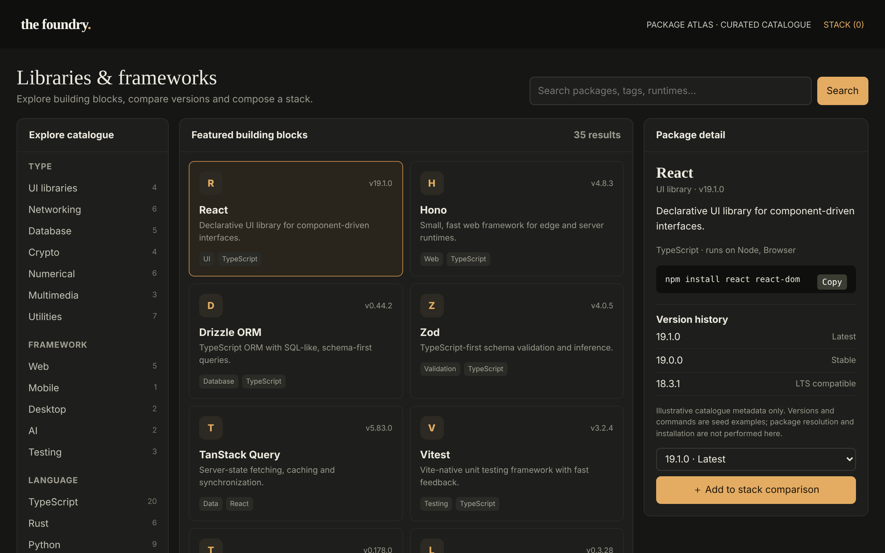

# The Foundry

Discover the components that make up a software stack.

An ACRYL Blends blueprint for the **Libraries & Frameworks** category (`acrylblends.libraries-foundry`, category 59 of 100): a curated package atlas: search and filter libraries and frameworks, read their metadata and version history, copy an install command and assemble a local stack with warnings and a manifest preview.



## Who it is for

Developers, architects, technical leads and engineering enablement teams.

## Start it

```sh
npm create acrylblends@latest my-atlas -- --from acrylblends.libraries-foundry
cd my-atlas
npm install
npm start      # the app on its own server; npm run dev opens it in the ACRYL frame
npm test       # domain and route tests
```

The first start seeds 35 illustrative packages across TypeScript, Rust and Python (React, Hono, Drizzle ORM, Zod, TanStack Query, Vitest, Three.js and LangChain first) and an empty stack. State is saved as JSON in the app's data home (`.acrylblends/foundry.json`); delete it to start over.

## What it does

| Screen | Path | What you can do |
| --- | --- | --- |
| Explore catalogue | left column | The Type, Framework and Language filters with the number of packages each has; one value per group, and picking it again clears it (`?group=`, `?framework=`, `?language=`). |
| Featured building blocks | `/` | The cards that match the search (`?q=`, every word across name, kind, summary, tags, languages and runtimes) and the filters; picking a card selects it (`?package=`). |
| Package detail | right column | The summary, the install command with a **Copy** button, the version history, and **Add to stack comparison** at a chosen version. |
| Stack comparison | `/stack` | The packages added, each pinned to a version and compared with the newest (Latest, 2 behind); re-pin, remove or clear; peer warnings; and the install commands and manifest the stack would produce. |

A stack holds each package once, at most twelve, at a version from the package's own history. A package that needs another (TanStack Query needs React 18+, pandas needs NumPy 2+) is flagged while the other is missing or pinned below that major. The manifest is grouped by ecosystem: `package.json` dependencies and devDependencies, `Cargo.toml` and `requirements.txt` lines.

## How it is made

Composed from Cordis plugins only; `blend.yaml` reads as what the app is made of:

| Row | Folder | Job |
| --- | --- | --- |
| `foundry` | `plugins/foundry/` | The domain (`ctx.atlas`): the catalogue, filters and search, the stack, manifest and checks, persistence behind a store port. |
| `foundry-shell` | `plugins/foundry-shell/` | The page shell (`ctx.foundryShell`): header, search, the three columns and the mockup's styles. |
| `filters`, `detail` | `plugins/<name>/` | The left and right columns. |
| `catalogue`, `stack` | `plugins/<name>/` | The first page and the stack page, which adds its link to the header. |

## Prototype boundaries

The metadata is illustrative seed data. Nothing is resolved from a registry, nothing is installed, and the commands are examples.

## Ask the chat next

1. "Add a compare view: pick two packages of the same type and show their versions, runtimes, languages and requirements side by side."
2. "Add a package submission form: a name, summary, language, install command and a first version, validated and added to the catalogue."
3. "Add a licence field to every package and warn on the stack page when two licences in the stack conflict."

Design: `design/spec.md` and `design/mockup.html`.
