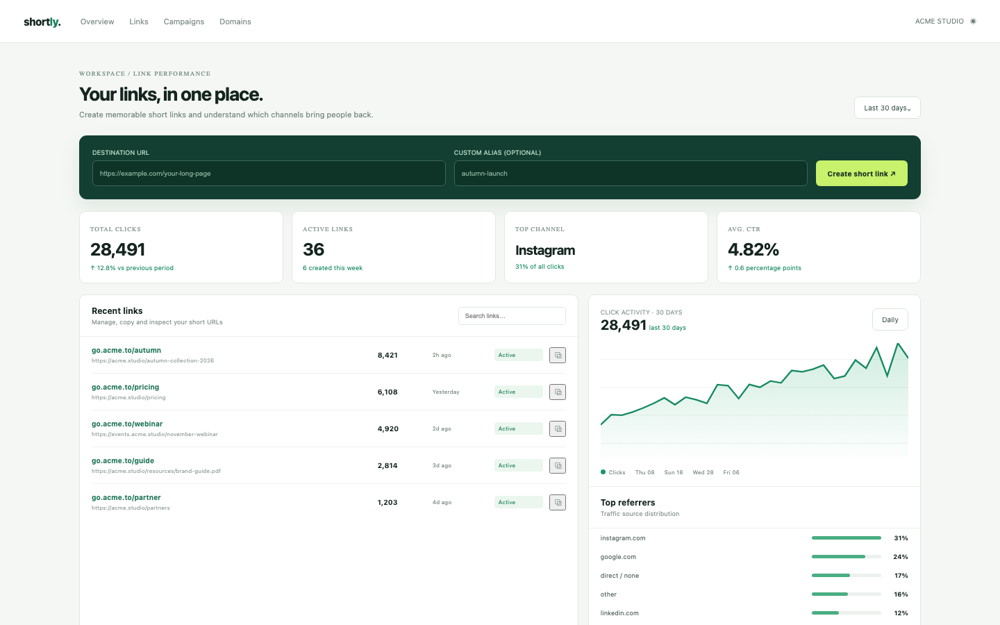

# Link Shortener

A branded short-link workspace: 39 links on three short domains, 28,491 sample clicks, a create composer with unique aliases, search and state filters, a 30-day click trend, referrer and country breakdowns, and a working `/s/:slug` redirect that records the click.

## Run it

```sh
npm install
npm start
```

Open the address it prints (the app keeps its data in `.acryl/`). `npm test` runs the suite with `node:test`; it needs no port and no credentials. The tests pin `TZ=UTC` and also pass under `TZ=America/Los_Angeles` and `TZ=Asia/Tokyo`:

```sh
TZ=America/Los_Angeles npm test
TZ=Asia/Tokyo npm test
```

## What is here

- **Overview** (`/`, `/links`): the create composer (destination URL and optional alias), the KPI strip (28,491 clicks, 36 active links, Instagram as the top channel, 4.82% CTR), the recent links with search and active/expired/disabled filters, the 30-day trend and the referrer breakdown.
- **Link detail** (`/links/:id`): the destination, alias and state, the 30-day chart, recent clicks, the referrer and country breakdowns, copy and enable/disable.
- **Campaigns** (`/campaigns`): the workspace tags with their links, active links and click totals.
- **Domains** (`/domains`): the three configured domains, their verification state and which one new links use.
- **The redirect** (`/s/:slug`): sends a browser to the destination and records the click; a disabled or expired link answers 410.

Every screen is its own Cordis plugin in `plugins/`, with a row in `blend.yaml` and a `plugin.json`. Settings > Plugins switches any of them off and only that feature leaves: turn `campaigns` off and `/campaigns` disappears while the links keep working.

## Notes on the design

The seed makes the mockup's numbers real: 39 links, 36 active (7 named plus 29 back-catalogue), 28,491 clicks, 4.82% CTR, the mockup's 31/24/17/12 referrer split and a previous 30-day period that gives the +12.8% and +0.6 point deltas. The daily series is deterministic but jittered per link, so the chart is a real sum rather than a straight line. Click breakdowns come from the 120 recorded sample events; the redirect adds real ones.

The boundaries follow the engineering books: `plugins/shortly` is pure domain code with an injected `Store`, `clock` and `newId` (Clean Architecture's dependency rule; DDD Distilled's short-link, click-event and domain language), and each screen is its own plugin so it can be switched off (A Philosophy of Software Design: module depth).

## What to ask the chat next

- Create a link with the alias `autumn-launch` and copy its short URL.
- Open the Autumn collection detail and explain the gap between 8,421 clicks and 174,700 views.
- Filter the links to the two expired ones and re-enable the disabled newsletter link.

## Screenshot


