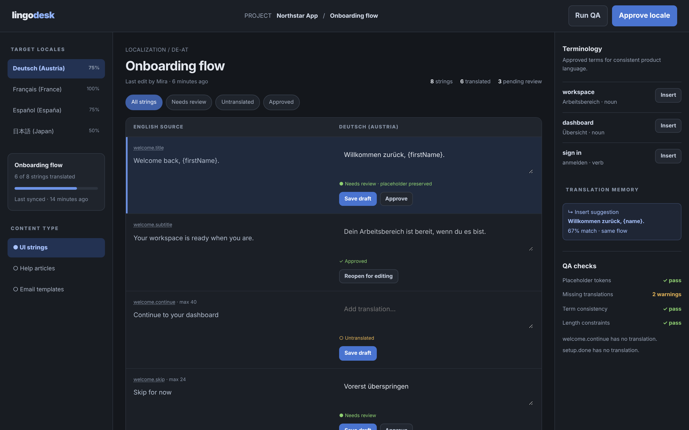

# LingoDesk

Translate at scale without losing the voice of the product.

An ACRYL Blends blueprint for the **Localization** category (`acrylblends.localization-lingodesk`, category 68 of 100): a translation-management and CAT workbench with target locales, source and target segments in draft, review and approved states, a glossary, translation-memory suggestions, and local QA checks.



## Who it is for

Localization managers, translators, product teams and language-service providers.

## Start it

```sh
npm create acrylblends@latest my-localization -- --from acrylblends.localization-lingodesk
cd my-localization
npm install
npm start      # the app on its own server; npm run dev opens it in the ACRYL frame
npm test       # domain and route tests
```

The first start seeds the Northstar App project: twelve message keys (UI strings, help articles, email templates) in four locales (de-AT, fr-FR, es-ES, ja-JP) with translations in every state; the de-AT screen reads as the mockup. State is saved as JSON in the app's data home (`.acrylblends/lingodesk.json`); delete it to start over.

## What it does

| Screen | Path | What you can do |
| --- | --- | --- |
| Locales and content | left rail | The target locales with their translated share, the project card and progress, and the content types (`?locale=`, `?type=`). |
| Editor | `/` | Source and target segments side by side; filter by All, Needs review, Untranslated or Approved (`?filter=`); select a segment (`?key=`); **Save draft**, **Approve** and **Reopen for editing**. |
| Terminology and translation memory | right column | The glossary for the locale with **Insert** per term, and the best translation-memory suggestion for the selected string with its match percentage. |
| QA and approval | top bar and right column | **Run QA** records the four checks (placeholder tokens, missing translations, term consistency, length limits); **Approve locale** is refused until QA passes. |

A translation is saved as a draft that needs review; clearing it makes it untranslated. An approved translation is read-only: an edit, an inserted term or a suggestion is refused until it is reopened, so it is never rewritten silently. A placeholder token such as `{firstName}` must appear in the target exactly as in the source. A translation-memory match is the share of words two strings have in common, shown from 60%. Approving a locale needs no QA error or warning (untranslated strings count); it then approves the strings that were waiting for review and changes nothing else.

## How it is made

Composed from Cordis plugins only; `blend.yaml` reads as what the app is made of:

| Row | Folder | Job |
| --- | --- | --- |
| `lingodesk` | `plugins/lingodesk/` | The domain (`ctx.desk`): message keys, segments, glossary, translation memory and QA, saved as JSON in the app's data home. |
| `desk-shell` | `plugins/desk-shell/` | The shell (`ctx.deskShell`): the top bar, the rail, the editor and the right column; side parts are registered by other plugins. |
| `locales` | `plugins/locales/` | The rail. |
| `editor` | `plugins/editor/` | The first page and the segment routes. |
| `glossary`, `qa` | `plugins/<name>/` | The right column, and Run QA and Approve locale in the top bar. |

## Prototype boundaries

Translations and QA are illustrative seeded examples. No machine-translation provider, localization service or production content is contacted, and nothing is published when a locale is approved.

## Ask the chat next

1. "Add import and export of a locale as an XLIFF file, keeping the message keys and placeholder tokens stable."
2. "Add a translation-memory write-back: when a segment is approved, add its source and target to the memory with the context."
3. "Add a length-constraint editor per key and show the remaining characters live while typing a translation."

Design: `design/spec.md` and `design/mockup.html`.
