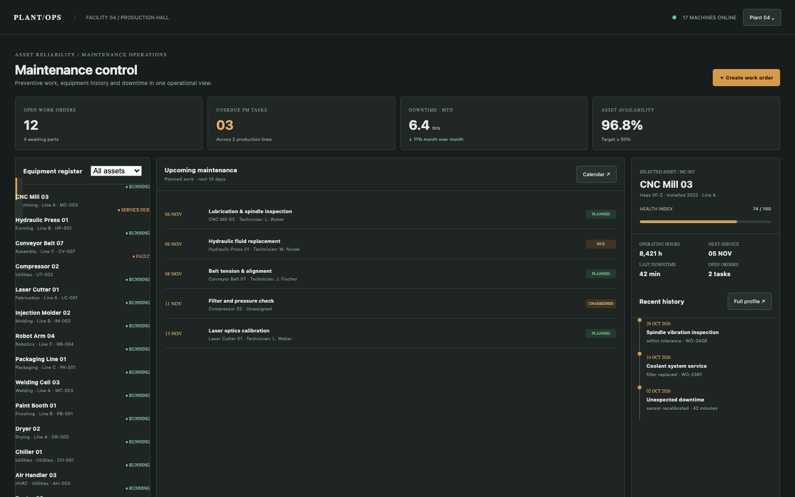

# Maintenance Log

An industrial maintenance control room: 18 machines, 12 open work orders (4 awaiting parts, 3 overdue), 6.4 hours of downtime this month, asset profiles with health and service history, and work orders that close only with a dated note and the recorded downtime. All machine states are seeded operational records; nothing sends a command to a PLC or SCADA system.

## Run it

```sh
npm install
npm start
```

Open the address it prints (the app keeps its data in `.acryl/`). `npm test` runs the suite with `node:test`; it needs no port and no credentials. The tests pin `TZ=UTC` and also pass under `TZ=America/Los_Angeles` and `TZ=Asia/Tokyo`:

```sh
TZ=America/Los_Angeles npm test
TZ=Asia/Tokyo npm test
```

## What is here

- **Maintenance control** (`/`): open work orders, overdue PM tasks, downtime MTD and asset availability, the equipment register with a status filter, the next five planned jobs and the selected asset's health and recent history.
- **Asset profile** (`/machines/:id`): operating hours, health index, next service, open tasks and the service history with costs and parts.
- **Work order detail** (`/work-orders/:id`): the fault, priority, technician, scheduled date, parts and checklist, with assign, reschedule, start and a dated close-out that records the downtime and writes a history event.
- **Create work order** (`/work-orders/new`): machine, kind, priority, fault, date, technician and parts, validated before it persists.

Every screen is its own Cordis plugin in `plugins/`, with a row in `blend.yaml` and a `plugin.json`. Settings > Plugins switches any of them off and only that feature leaves: turn `machines` off and `/machines/:id` disappears while the control room keeps working.

## Notes on the design

The seed makes the mockup's numbers real: 18 machines, 12 open work orders of which 4 have parts, 3 overdue across 2 lines, six November close-outs whose downtime sums to 384 minutes (6.4 hours) and a seeded fleet availability of 96.8% that falls as extra downtime is closed out. The mockup's first five machines, the schedule and the CNC history keep their names and dates; a deterministic back catalogue fills the register. Close-out is a domain rule: a note is required, downtime is bounded, the checklist completes and an event is written.

The boundaries follow the engineering books: `plugins/plant` is pure domain code with an injected `Store`, `clock` and `newId` (Clean Architecture's dependency rule; DDD Distilled's machine, work-order and maintenance-event language), and each screen is its own plugin (A Philosophy of Software Design: module depth).

## What to ask the chat next

- Close WO-2402 with a note and 45 minutes of downtime, then check the downtime KPI and the asset history.
- Filter the register to fault assets and open the Compressor 02 profile.
- Create a repair order for the Hydraulic Press with the parts `seal kit, oil` and assign it to M. Novak.

## Screenshot


