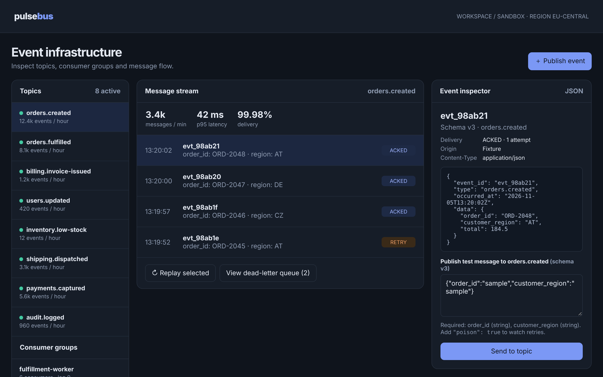

# Pulsebus

Inspect event streams and consumer health.

An ACRYL Blends blueprint for the **Messaging Infrastructure** category (`acrylblends.messaging-pulsebus`, category 56 of 100): an event-bus explorer
with topics and consumer groups, a message stream with delivery and retry state, a JSON payload inspector, schema-validated synthetic publishing,
replay and a dead-letter queue.



## Who it is for

Backend engineers, integration teams, platform operators and event-driven architects.

## Start it

```sh
npm create acrylblends@latest my-bus -- --from acrylblends.messaging-pulsebus
cd my-bus
npm install
npm start      # the app on its own server; npm run dev opens it in the ACRYL frame
npm test       # domain and route tests
```

The first start seeds eight topics with schemas, three consumer groups, the newest messages of each topic (one retrying in `orders.created`) and two
dead letters. State is saved as JSON in the app's data home (`.acrylblends/pulsebus.json`); delete it to start over.

## What it does

| Where | Path | What you can do |
| --- | --- | --- |
| Topics and groups | left column | Pick a topic (`?topic=`); each consumer group shows its consumers and lag. |
| Message stream | `/` | The topic's throughput, latency and delivery, its messages newest first with `ACKED`, `RETRY`, `LOCAL` or `DEAD`; **Replay selected**. |
| Event inspector | right column | The selected message (`?message=`) as a JSON envelope with schema version, delivery and last error; **Publish test message**. |
| Dead-letter queue | `/dead-letters` | Messages that failed three deliveries, with the reason; **Redrive** (a fresh attempt) or **Discard**. |

Publishing checks the JSON against the topic's schema (a JSON object, required fields present, field types right) and says what is wrong. A valid event
is delivered and shown as `LOCAL`; add `"poison": true` and the consumer rejects it on every delivery: each replay is another attempt, and the third
sends it to the dead-letter queue. Replaying an acknowledged message counts a replay; replaying a retrying one can recover it.

## How it is made

Composed from Cordis plugins only; `blend.yaml` reads as what the app is made of:

| Row | Folder | Job |
| --- | --- | --- |
| `pulsebus` | `plugins/pulsebus/` | The domain (`ctx.bus`): topics and schemas, groups, the delivery state machine, validation, persistence behind a store port. |
| `bus-shell` | `plugins/bus-shell/` | The explorer shell (`ctx.busShell`): header, title and the three columns. |
| `topics`, `inspector` | `plugins/<name>/` | The left and right columns. |
| `stream`, `dead-letters` | `plugins/<name>/` | The centre page and the dead-letter page. |

## Prototype boundaries

Everything is a local fixture. No broker is contacted, no message leaves the app, and the throughput and latency figures are illustrative.

## Ask the chat next

1. "Add a consumer-group offsets view: per partition, the committed offset and the lag, with a reset-to-latest button that records an audit entry."
2. "Add schema evolution: let me add a field to a topic's schema as v+1, validate new events against it, and show which messages were published under which version."
3. "Add a simple filter to the stream: by delivery state and by a payload field, kept in the URL."

Design: `design/spec.md` and `design/mockup.html`.
