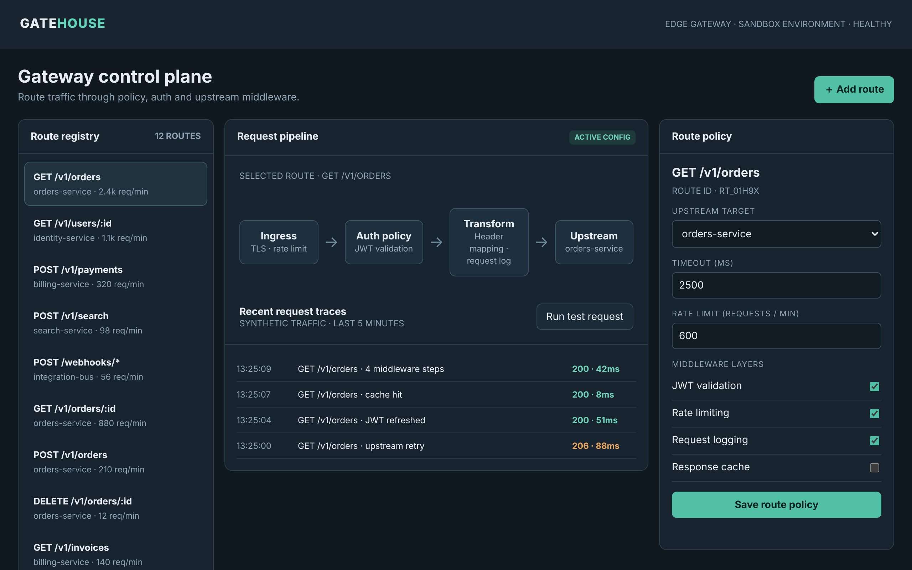

# Gatehouse

Shape requests as they pass through your middleware stack.

An ACRYL Blends blueprint for the **Middleware** category (`acrylblends.middleware-gatehouse`, category 57 of 100): an API-gateway control plane with a route registry, an ordered middleware pipeline per route, upstream services, request traces and a route-policy draft.



## Who it is for

Backend platform engineers, API architects and integration teams.

## Start it

```sh
npm create acrylblends@latest my-gate -- --from acrylblends.middleware-gatehouse
cd my-gate
npm install
npm start      # the app on its own server; npm run dev opens it in the ACRYL frame
npm test       # domain and route tests
```

The first start seeds five upstream services, twelve routes (GET /v1/orders is selected) and the recent traces of that route. State is saved as JSON in the app's data home (`.acrylblends/gatehouse.json`); delete it to start over.

## What it does

| Screen | Path | What you can do |
| --- | --- | --- |
| Route registry | left column | Pick a route (`?route=`); **Add route** registers one with the default policy (JWT, rate limit and logging on, cache off). Upstream services sit below, each with a **Mark down** switch. |
| Request pipeline | `/` | The selected route's ordered middleware: Ingress, Auth policy, Transform, an optional Response cache, then the Upstream; a layer switched off stays on the diagram, dimmed. **Run test request** simulates a request and records its trace. |
| Route policy | right column | The upstream target, timeout, rate limit and the four layers as a draft: **Save route policy** keeps the draft, **Apply to pipeline** makes it the policy in force, **Discard draft** drops it. |

A test request is a deterministic simulation: latency plus 2 ms per active layer, 8 ms for a warm cache hit, `429` once the rate limit is reached in the minute, `504` when the upstream is slower than the timeout, `502` when it is marked down. The pipeline only changes when a draft is applied.

## How it is made

Composed from Cordis plugins only; `blend.yaml` reads as what the app is made of:

| Row | Folder | Job |
| --- | --- | --- |
| `gatehouse` | `plugins/gatehouse/` | The domain (`ctx.gate`): routes, policies and drafts, upstreams, the pipeline and the request simulation, persistence behind a store port. |
| `gate-shell` | `plugins/gate-shell/` | The page shell (`ctx.gateShell`): header, title, the three columns and the mockup's styles. |
| `routes`, `upstreams` | `plugins/<name>/` | The left column. |
| `pipeline` | `plugins/pipeline/` | The centre page. |
| `policy` | `plugins/policy/` | The right column. |

## Prototype boundaries

Nothing is proxied: no request reaches a real service, and the latencies and traffic figures are fixtures.

## Ask the chat next

1. "Add a transform editor: let me list header rewrites for a route, show them in the Transform node, and apply them in the simulated trace."
2. "Add per-route canary routing: send a percentage of test requests to a second upstream and show the split in the traces."
3. "Add an audit log: record every applied policy with who changed what, and let me roll a route back to a previous policy."

Design: `design/spec.md` and `design/mockup.html`.
