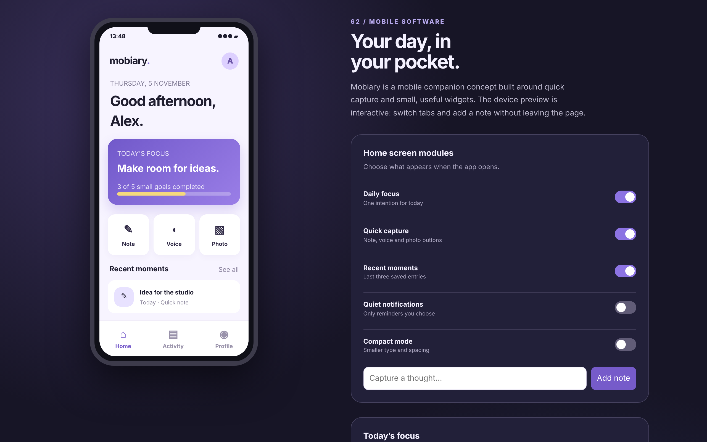

# Mobiary

A compact mobile companion for the moments between meetings.

An ACRYL Blends blueprint for the **Mobile** category (`acrylblends.mobile-mobiary`, category 62 of 100): a mobile-first field journal shown as a phone preview with Home, Capture, Activity and Profile screens, quick capture, home-screen modules you can switch, a daily focus with small goals, and compact and quiet preferences.



## Who it is for

Mobile product teams, field workers and people who capture short notes while moving.

## Start it

```sh
npm create acrylblends@latest my-journal -- --from acrylblends.mobile-mobiary
cd my-journal
npm install
npm start      # the app on its own server; npm run dev opens it in the ACRYL frame
npm test       # domain and route tests
```

The first start seeds Alex's journal: a daily focus with three of five small goals done, three moments and all three home modules on. State is saved as JSON in the app's data home (`.acrylblends/mobiary.json`); delete it to start over.

## What it does

| Screen | Path | What you can do |
| --- | --- | --- |
| Home | `/` | The greeting by the hour, today's focus with its progress, the Note / Voice / Photo buttons and the three latest moments. Each part shows only while its module is on. |
| Capture | `/capture` | A note, or a voice-memo or photo placeholder (`?kind=`), with a short description; saving puts it at the top of Activity. The panel beside the phone has a quick-note form too. |
| Activity | `/activity` | Every saved moment, newest first, filtered by kind (`?kind=`), each with a delete. |
| Profile | `/profile` | The person, editable quiet hours, and what the notification preference means now. |
| Companion panel | beside the phone | Switches for the home modules, quiet notifications and compact mode, and today's focus with up to five goals you can check off. |

At least one home module stays on. Compact mode shrinks the preview's type and spacing; quiet notifications changes what Profile says. A moment is one to eighty characters, and the journal holds at most two hundred. Quiet hours need two different `HH:MM` times.

## How it is made

Composed from Cordis plugins only; `blend.yaml` reads as what the app is made of:

| Row | Folder | Job |
| --- | --- | --- |
| `mobiary` | `plugins/mobiary/` | The domain (`ctx.journal`): entries, the focus and goals, widgets and preferences, persistence behind a store port. |
| `phone-shell` | `plugins/phone-shell/` | The device shell (`ctx.phoneShell`): the phone, its tab bar and the companion panel, with the mockup's styles. |
| `today`, `activity`, `profile` | `plugins/<name>/` | One screen each, registering its tab so it leaves with the plugin. |
| `capture`, `widgets` | `plugins/<name>/` | The capture screen (no tab) and the companion panel. |

## Prototype boundaries

Voice memos and photos are placeholders: nothing is recorded and no camera is used. Everything stays on this computer.

## Ask the chat next

1. "Add a weekly review screen that groups the last seven days of moments by kind and shows how many goals were done each day."
2. "Add tags to moments (a few words after a #) and a tag filter on Activity."
3. "Add a home-screen widget for the next reminder, with a reminder form that respects the quiet hours."

Design: `design/spec.md` and `design/mockup.html`.
