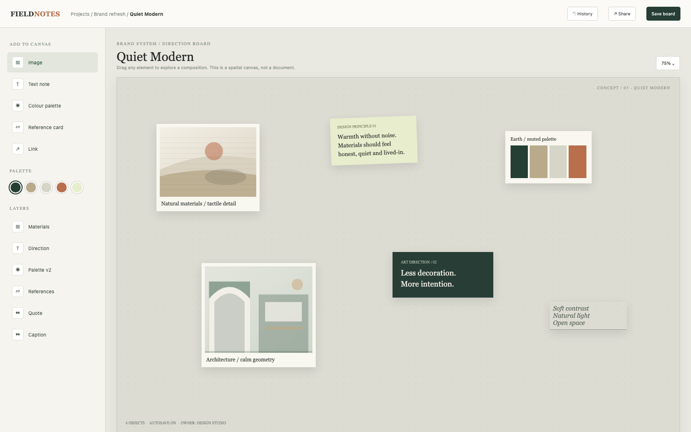

# Moodboard

A spatial direction board for a design project: six typed objects on a dotted paper canvas, a palette rail, layers, an asset library, board settings and a JSON export. Every object's position and layer is explicit in the saved data, and every reference image is drawn locally, so the app runs with no network and no stock service.

## Run it

```sh
npm install
npm start
```

Open the address it prints (the app keeps its data in `.acryl/`). `npm test` runs the suite with `node:test`; it needs no port and no credentials. The tests pin `TZ=UTC` and also pass under `TZ=America/Los_Angeles` and `TZ=Asia/Tokyo`:

```sh
TZ=America/Los_Angeles npm test
TZ=Asia/Tokyo npm test
```

## What is here

- **Canvas** (`/`): the Quiet Modern board with six objects. Drag an element, or focus it and use the arrow keys; either way the position is autosaved. The palette rail selects a colour, the layers panel opens an object, and the tools add a new one.
- **Objects** (`/objects/new`, `/objects/:id/edit`): the add form for every type (image, note, colour palette, reference card, quote, caption, link) and the editor with duplicate, bring forward, send back and delete.
- **Assets** (`/assets`): three reference images and five palette colours, an add form, and Use on board for any asset.
- **Settings** (`/settings`): title, project, dimensions, collaborators, the last save time and the JSON export at `/export.json`.
- **Save board** in the top bar confirms autosave; History and Share are local demo actions.

Every screen is its own Cordis plugin in `plugins/`, with a row in `blend.yaml` and a `plugin.json`. Settings > Plugins switches any of them off and only that feature leaves: turn `settings` off and `/settings` and the export disappear while the canvas keeps its objects.

## Notes on the design

The mockup's six objects, their positions (percentages of the board), layers and palette are the seed data. The mockup's stock photographs are replaced with generated SVGs (material, architecture, window light, fabric) because the demo must run offline; the card geometry and captions match the mockup.

The boundaries follow the engineering books: `plugins/boards` is pure domain code with a small injected `Store`, `clock` and `newId` (Clean Architecture's dependency rule; DDD Distilled's ubiquitous language of board, object, layer and asset), and each screen is its own plugin so a feature can be switched off without touching the rest (A Philosophy of Software Design: module depth and information hiding).

## What to ask the chat next

- Add a note at the lower right that says "Texture before colour" and bring it to the front.
- Add a fabric reference image to the Assets library, then place it beside the architecture card.
- Change the board to 1400 x 900, add Sam Lee as a collaborator, and download the JSON export.

## Screenshot


