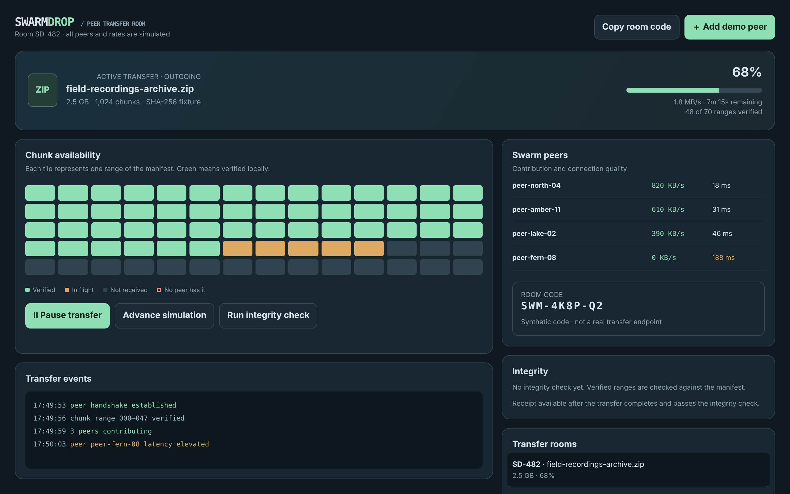

# Swarmdrop

Transfer large files through cooperating peers.

An ACRYL Blends blueprint for the **Peer-to-peer software** category (`acrylblends.p2p-swarmdrop`, category 74 of 100): a peer-to-peer transfer room with a chunk availability map and rarest-first requests, synthetic peers with rate and latency, a pausable simulation with a corrupt-copy retry, integrity verification and a completion receipt, and rooms to create or join by code.



## Who it is for

Teams sharing large files, distributed compute groups and P2P product developers.

## Start it

```sh
npm create acrylblends@latest my-p2p -- --from acrylblends.p2p-swarmdrop
cd my-p2p
npm install
npm start      # the app on its own server; npm run dev opens it in the ACRYL frame
npm test       # domain and route tests
```

The first start seeds room SD-482 as in the mockup (field-recordings-archive.zip, 68%, four peers at 1.8 MB/s), a paused incoming room SD-517 and a finished room SD-390 with its receipt. State is saved as JSON in the app's data home (`.acrylblends/swarmdrop.json`); delete it to start over.

## What it does

| Screen | Path | What you can do |
| --- | --- | --- |
| Transfer room | `/` | The file hero with progress, speed and time remaining, and the room line (`?room=`). |
| Chunk availability | main column | 70 range tiles (verified, in flight, not received, no peer has it); pick one (`?range=`) to see its chunks, hash fixture and holders. **Pause / Resume**, **Advance simulation** (one step) and **Run integrity check**; below it the transfer events. |
| Swarm peers | right column and header | Each peer's rate and latency; pick one (`?peer=`) for its connection quality, upload and download rate, share and ranges held; **Disconnect peer**; **＋ Add demo peer**; the room code. |
| Integrity and receipt | right column | The latest integrity check and, for a complete and verified transfer, the receipt with the manifest digest and each peer's share. |
| Transfer rooms | right column and header | Switch rooms, create one for a file name and size, join one by its code, close one; **Copy room code**. |

Each step verifies the ranges in flight (a corrupt copy fails once and is requested again), then requests up to peers+2 missing ranges, the ones the fewest sending peers hold first. A range no sending peer holds is never requested; with nothing left to request the transfer reports a stall. A transfer is complete when every range is verified; the receipt needs a passing integrity check. Peers hold deterministic subsets of the ranges, so the same room always behaves the same. A room holds at most 12 peers and at most 6 rooms exist.

## How it is made

Composed from Cordis plugins only; `blend.yaml` reads as what the app is made of:

| Row | Folder | Job |
| --- | --- | --- |
| `swarmdrop` | `plugins/swarmdrop/` | The domain (`ctx.swarm`): rooms, chunk ranges, peers, the step simulation, integrity checks and receipts, saved as JSON in the app's data home. |
| `swarm-shell` | `plugins/swarm-shell/` | The shell (`ctx.swarmShell`): the header, the hero and the two columns; every region is a part other plugins register. |
| `room` | `plugins/room/` | The first page and the file hero. |
| `chunks`, `events` | `plugins/<name>/` | The main column, with the pause, advance and verify routes. |
| `peers`, `receipt`, `rooms` | `plugins/<name>/` | The right column and the header buttons. |

## Prototype boundaries

Nothing is transferred: no socket is opened, no file is read, and every peer, rate and hash is a fixture made by a seeded generator. Room codes are synthetic and are not real transfer endpoints.

## Ask the chat next

1. "Add a choke and unchoke policy: peers uploading little are throttled, and the swarm rate and fairness are shown per peer."
2. "Add a transfer history per room that charts progress and rate after every simulation step as inline SVG."
3. "Add a manifest view that lists every chunk range with its hash fixture and lets a corrupt range be injected to test the retry."

Design: `design/spec.md` and `design/mockup.html`.
