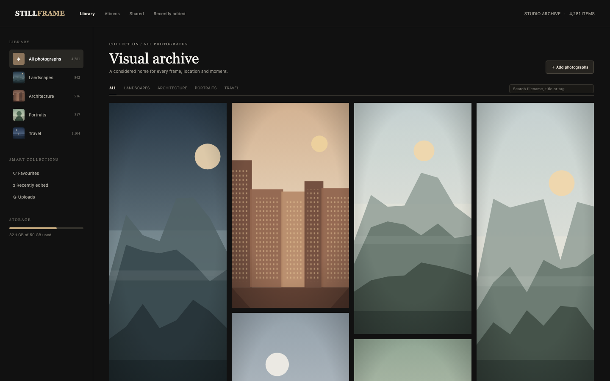

# Photo Gallery

An editorial photo archive built from the ACRYL Blends Photo Gallery blueprint: four albums with 4,281 seeded photographs, a charcoal masonry library, favourites, sharing, an offline lightbox and an upload form. Every preview is drawn locally as an SVG from its style and palette, so the app runs with no network, no stock imagery and no API key.

## Run it

```sh
npm install
npm start
```

Open the address it prints (the app keeps its data in `.acryl/`). `npm test` runs the suite with `node:test`; it needs no port and no credentials. The tests pin `TZ=UTC` and also pass under `TZ=America/Los_Angeles` and `TZ=Asia/Tokyo`:

```sh
TZ=America/Los_Angeles npm test
TZ=Asia/Tokyo npm test
```

## What is here

- **Library** (`/`): the album tabs, the archive search, the masonry grid and the pager over all 4,281 frames.
- **Albums** (`/albums`, `/albums/:id`): the four collections with covers, counts, capture range and album size.
- **Smart collections**: Favourites, Recently edited and Uploads (`/favourites`, `/edited`, `/uploads`), plus Recently added (`/recent`) in the top bar.
- **Shared** (`/shared`): the frames marked shareable. Sharing is a local flag; nothing leaves the machine.
- **Lightbox** (`/photos/:id`): the frame at full size with filename, capture date, dimensions, size, tags, previous and next, favourite and share.
- **Upload** (`/upload`): a validated add form with a live generated preview. The original would go to configured storage in a real app; this demo draws the frame instead.

Every screen is its own Cordis plugin in `plugins/`, with its own row in `blend.yaml` and a `plugin.json`. Settings > Plugins switches any of them off and only that feature leaves: turn `collections` off and `/favourites` and the smart-collection rail rows disappear while the library keeps working.

## Notes on the design

The mockup's counts are real data: the seed fills the four albums to 842, 516, 317 and 1,104, and the remaining 1,502 are unfiled imports, so the storage bar reads the mockup's 32.1 GB of 50 GB from the files themselves. The mockup's stock photographs are replaced with generated offline artwork, which the spec allows the demo to do with local assets; the grid keeps the mockup's pinned tile heights.

The boundaries follow the engineering books: the domain (`plugins/gallery`) is pure and has no disk, clock or router import (Clean Architecture's dependency rule), persistence is a small `Store` port injected by the plugin (Dependency Inversion), and each screen is a separate plugin because a feature should be deep and independently switchable (A Philosophy of Software Design: information hiding and module depth).

## What to ask the chat next

- Add a photograph called `north-window.jpg` to the Portraits album with a portrait preview and the tags `window light, studio`.
- Search the archive for `harbour` and make the first result a favourite.
- Open the Travel album, share its newest frame, and confirm it appears under Shared.

## Screenshot


