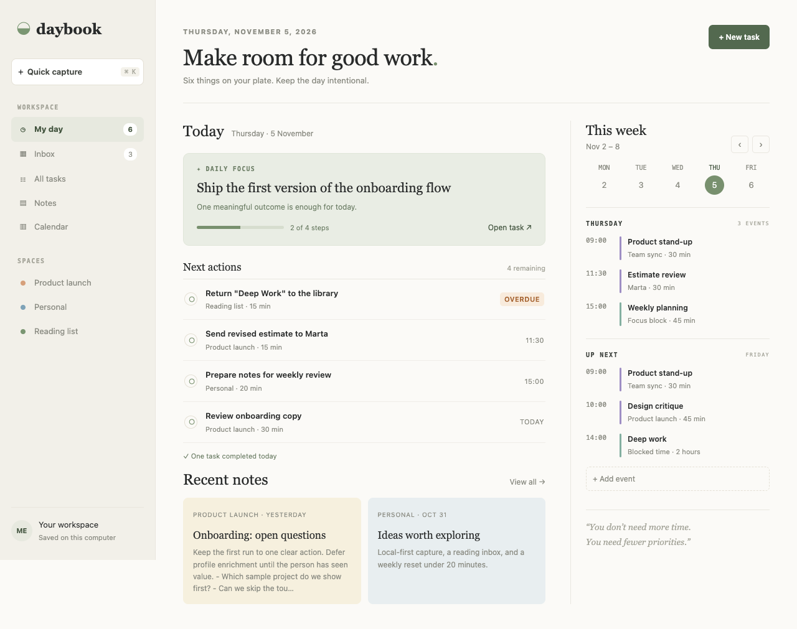

# Productivity Hub

A calm personal workbench that starts with your day, not a report: one daily focus, the next actions, recent notes and the week's agenda on
one page, with quick capture into an inbox you triage into tasks or notes, and a week calendar that asks before two events overlap.



**For** one person who wants their tasks, notes and calendar in one quiet place without project-management machinery: a freelancer, a
product person, a student.

An [ACRYL Blends](https://acrylblends.github.io) blueprint (`acrylblends.productivity-hub`), made from the blank template. Every page is a
Cordis plugin of its own that you can switch off or replace.

## Start it

```sh
npm install
npm start          # the app on its own; prints its address
npm test
npm run check      # the type check
```

Set `ACRYLBLENDS_PORT` to choose the first port tried. Everything is saved on this computer, in `productivity-hub.json` in the app's data
folder (printed at start). It calls no service, so it needs no account, key or network. The first launch fills it with a believable week
(three spaces, six tasks, four notes, three captures, meetings and focus blocks) laid around the day you start it.

## The pages

- **My Day** (`/`): today's focus with its steps, the next actions (an overdue one first, marked), what you finished today, two recent notes,
  and on the right this week's strip with today's events and the next day's.
- **Inbox** (`/inbox`): everything you captured (the sidebar field, Cmd/Ctrl+K from any page), each turned into a task (with a date, a space
  and an estimate) or a note, or discarded.
- **All tasks** (`/tasks`): every task grouped as Overdue, Today, Upcoming, No date and Completed; filter by status, space or text; add,
  edit, complete and reopen.
- **Notes** (`/notes`, `/notes/:id`): pastel cards by space; the editor shows Saved or Unsaved changes, warns before you leave with unsaved
  words, and links tasks to the note.
- **Calendar** (`/calendar`): the week as a time grid of meetings, focus blocks and personal time. An event that overlaps another is held:
  the page names what it overlaps and saves it only when you choose Save anyway. Overlaps already in the week are outlined.

Light and dark follow your system.

## Ask the chat next

1. "Add a weekly review page that lists what I completed this week by space and lets me pick next week's focus."
2. "Let me drag a task from Next actions onto the calendar to block time for it, using its estimate as the length."
3. "Add recurring events: every weekday, every week or every month, and show the overlap warning for each occurrence."

## How it is built

| Plugin | Row | What it does |
| --- | --- | --- |
| `plugins/productivity-hub/` | `productivity-hub` | The domain as `ctx.hub`: the data, the seed, overlap detection and validation, saved through the `HubStore` port (a JSON file; tests use memory). |
| `plugins/hub-shell/` | `hub-shell` | The page shell as `ctx.hubShell`: sidebar, quick capture, the paper look in light and dark. |
| `plugins/my-day/` | `my-day` | `/`: the focus, next actions, done today and recent notes from `ctx.hub`; the calendar's `ctx.home` widget in the rail. |
| `plugins/inbox/` | `inbox` | `/inbox`: capture and triage. |
| `plugins/tasks/` | `tasks` | `/tasks`: every task, grouped and filtered; add, edit, complete. |
| `plugins/notes/` | `notes` | `/notes`, `/notes/:id`: the cards and the editor. |
| `plugins/calendar/` | `calendar` | `/calendar`, and This week in My Day's rail. |

`blend.yaml` lists the rows; `disabled: true` on a page's row (Settings > Plugins in the ACRYL frame) takes the page and its sidebar entry away
together; My Day keeps its sections and drops its links to that page (without the calendar, its rail is a plain agenda). The tests (`node:test`) cover the domain and every route with a fake clock and a memory store.
`AGENTS.md` describes the layout for an agent. The design this was built from is in `design/`.
