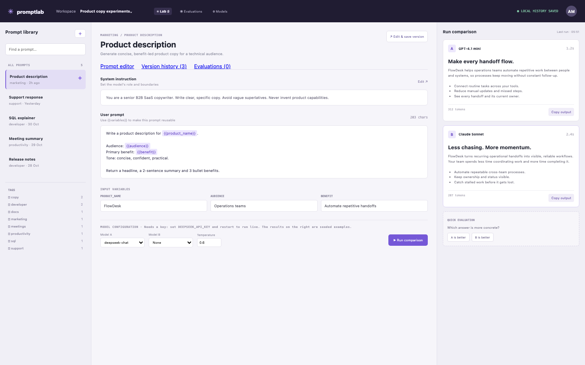

# Prompt Lab

A prompt engineering workbench: a reusable prompt library with variables, side-by-side model runs and quick evaluations, on the model you configure. It works without a key, showing its seeded comparison outputs, and says on the page what to set to run live.

## Run it

```sh
npm install
npm start
```

Open the address it prints. `npm test` runs the tests (node:test; no network, no key).

## What to ask the chat next

- Make a prompt that turns a support ticket into a short reply, with three variables.
- Add a second comparison model and save the better answer as a new version.
- Add an evaluation criterion for tone and rate the two seeded answers.

## Screenshot


