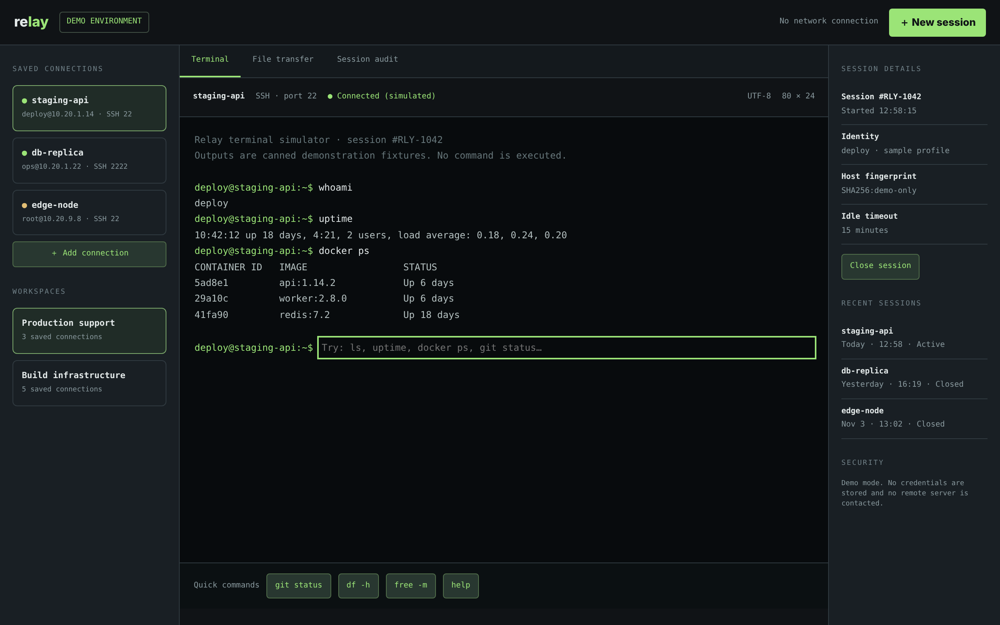

# Remote Relay

A focused workspace for remote sessions and terminal access.

An ACRYL Blends blueprint for the **Remote Computing** category (`acrylblends.remote-relay`, category 53 of 100): saved SSH-style connection profiles,
simulated terminal sessions, a file-transfer queue and a session audit log.



## Who it is for

Developers, system administrators, support engineers and remote-operations teams who want a starting point for a remote-access console.

## Start it

```sh
npm create acrylblends@latest my-relay -- --from acrylblends.remote-relay
cd my-relay
npm install
npm start      # the app on its own server; npm run dev opens it in the ACRYL frame
npm test       # domain and route tests
```

The first start seeds two workspaces with eight saved connections, the active session `RLY-1042` on `staging-api`, two closed sessions, two transfers
and their audit trail. State is saved as JSON in the app's data home (`.acrylblends/relay.json`); delete it to start from the seed again.

## What it does

| Screen | Path | What you can do |
| --- | --- | --- |
| Terminal | `/` | Pick a connection (`?profile=`); run `whoami`, `pwd`, `hostname`, `ls`, `uptime`, `docker ps`, `git status`, `df -h`, `free -m` or `help` by typing or with the quick buttons. Anything else is denied and logged. **New session** opens a session, **Close session** ends it. |
| File transfer | `/transfer` | Queue a sample file, then step it through Queued, Ready, Running and Completed, or cancel it. Overwrite is off: a name already in the queue is refused. |
| Session audit | `/audit` | The session's event log with each command's result (`Exit 0`, `Denied`) and the connection's details. |

The left column holds the saved connections of a workspace (the dot is the host's health) and **Add connection**; the right column holds the session's
id, start, identity, fingerprint and idle timeout, and the recent sessions.

A session is a small state machine: **active**, **timed out** (15 idle minutes, refreshed by every command) or **closed**. A profile has at most one live
session, and a timed-out one is closed when a new one opens.

## How it is made

Composed from Cordis plugins only; `blend.yaml` reads as what the app is made of:

| Row | Folder | Job |
| --- | --- | --- |
| `relay` | `plugins/relay/` | The domain (`ctx.relay`): profiles, sessions, the allowlisted commands, transfers, the audit log, persistence behind a store port. |
| `relay-shell` | `plugins/relay-shell/` | The page shell (`ctx.relayShell`): top bar, three columns, tabs, session bar and the mockup's styles. |
| `connections`, `session-rail` | `plugins/<name>/` | The left and right columns. |
| `terminal`, `transfers`, `audit` | `plugins/<name>/` | One plugin per tab, each registering its tab so it leaves with the plugin. |

## Prototype boundaries

This is a simulator. No command is executed, no file moves, no credential is stored and no remote server is contacted. Outputs are canned fixtures.

## Ask the chat next

1. "Add a command palette on Cmd+K that lists the allowlisted commands and runs the one I pick in the current session."
2. "Let me tag connections and filter the left column by tag, and show a tag on each connection in the audit tab."
3. "Add a transfer progress bar that advances by itself while a job is running, with a pause button, and log each step in the audit."

Design: `design/spec.md` and `design/mockup.html`.
