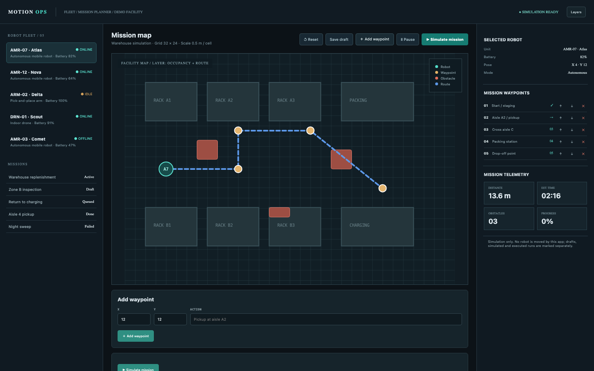

# Robot Missions

A map-first mission planner for a robot fleet: five robots, five missions with ordered waypoints, a facility map with racks and obstacles, route preview, run/pause/reset simulation, robot telemetry history and an event log. Simulation only: the app never connects to a robot controller or sends motion commands.

## Run it

```sh
npm install
npm start
```

Open the address it prints (the app keeps its data in `.acryl/`). `npm test` runs the suite with `node:test`; it needs no port and no credentials. The tests pin `TZ=UTC` and also pass under `TZ=America/Los_Angeles` and `TZ=Asia/Tokyo`:

```sh
TZ=America/Los_Angeles npm test
TZ=Asia/Tokyo npm test
```

## What is here

- **Mission planner** (`/`, `/missions/:id`): the fleet rail and mission list, the facility map with racks, obstacles, waypoints and the robot pin, the waypoint editor with add, remove and reorder, save draft, and the run/pause/reset simulation with distance, time, obstacle and progress telemetry.
- **Robot detail** (`/robots/:id`): battery, pose, mode, five telemetry samples and the missions assigned to the unit.
- **Mission history** (`/missions`): every mission with its status, robot and waypoint count, and the simulation event log including the failed night sweep.

Every screen is its own Cordis plugin in `plugins/`, with a row in `blend.yaml` and a `plugin.json`. Settings > Plugins switches any of them off and only that feature leaves: turn `history` off and `/missions` disappears while the planner keeps working.

## Notes on the design

The seed is the mockup's facility: 32 x 24 cells at 0.5 m per cell, three obstacles, the Warehouse replenishment route, four robots plus a fifth charging unit, and five missions including a failed night sweep with its event. Route distance is the real path length (13.6 m for the active route), and the estimated time uses a 0.1 m/s simulation speed; the mockup's 48.2 m does not match its own 0.5 m/cell scale, so the app keeps the honest number. Draft, paused, simulated and failed are distinct mission states.

The boundaries follow the engineering books: `plugins/fleet` is pure domain code with an injected `Store`, `clock` and `newId` (Clean Architecture's dependency rule; DDD Distilled's robot, mission, waypoint and event language), and each screen is its own plugin (A Philosophy of Software Design: module depth).

## What to ask the chat next

- Add a waypoint at 12, 6, move it to the top of the route and save the draft.
- Run the Zone B inspection simulation, pause it and reset it, then read the event log.
- Open the AMR-03 Comet profile and explain why an offline charging robot has no active mission.

## Screenshot


