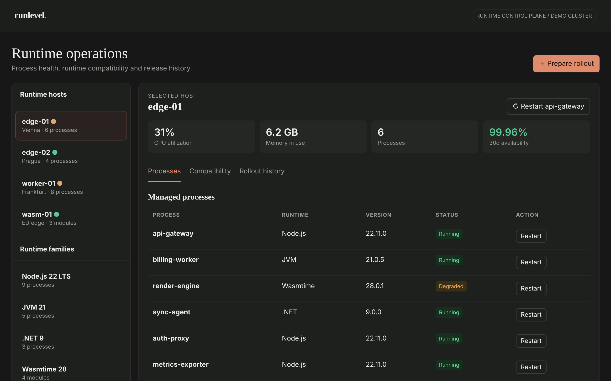

# Runlevel

Manage process health and runtime compatibility.

An ACRYL Blends blueprint for the **Runtime** category (`acrylblends.runtime-runlevel`, category 58 of 100): a runtime operations desk with hosts and managed processes, simulated restarts, a runtime compatibility matrix and rollout drafts with history and roll-back.



## Who it is for

Platform engineers, SREs, runtime maintainers and application operations teams.

## Start it

```sh
npm create acrylblends@latest my-runtimes -- --from acrylblends.runtime-runlevel
cd my-runtimes
npm install
npm start      # the app on its own server; npm run dev opens it in the ACRYL frame
npm test       # domain and route tests
```

The first start seeds four hosts (edge-01 is selected), 21 managed processes across Node.js, JVM, .NET and Wasmtime, four compatibility rules, three past rollouts and a lifecycle log. State is saved as JSON in the app's data home (`.acrylblends/runlevel.json`); delete it to start over.

## What it does

| Screen | Path | What you can do |
| --- | --- | --- |
| Hosts and families | left column | Pick a host (`?host=`); the dot shows whether any of its processes is degraded. Runtime families show how many processes run each runtime. |
| Processes | `/` | The host's managed processes with runtime, version and status. **Restart** requests a simulated restart (Running, Restarting), **Complete restart** is the local confirmation; the top button restarts the selected process. |
| Compatibility | `/compat` | The matrix: workload, current and target runtime, and a verdict (Verified, Review, Blocked) with the reason. |
| Rollout history | `/rollouts` | Past rollouts with their outcome. **Prepare rollout** checks a process and a target version against the matrix and makes a draft; **Run rollout**, **Discard**, and **Roll back** a succeeded one. |

A rollout to a version that is not newer than the process's, or that the matrix blocks, is refused with the reason. A *Review* verdict is allowed but leaves the process degraded until it is restarted. A process has at most one draft, and a rollout can only be rolled back while the process still runs its version.

## How it is made

Composed from Cordis plugins only; `blend.yaml` reads as what the app is made of:

| Row | Folder | Job |
| --- | --- | --- |
| `runlevel` | `plugins/runlevel/` | The domain (`ctx.desk`): hosts, processes and the restart states, compatibility rules, rollouts, the lifecycle log, persistence behind a store port. |
| `run-shell` | `plugins/run-shell/` | The page shell (`ctx.runShell`): header, title, the host's heading and statistics, tabs and the mockup's styles. |
| `hosts` | `plugins/hosts/` | The left column. |
| `processes`, `compat`, `rollouts` | `plugins/<name>/` | One plugin per tab, each registering its tab so it leaves with the plugin. |

## Prototype boundaries

Everything is simulated: no process is touched, no runtime is installed, and the CPU, memory and availability figures are fixtures.

## Ask the chat next

1. "Add a maintenance window to each host: refuse restarts and rollouts outside it, and show the next window in the host's heading."
2. "Add a canary rollout: roll a draft to one process of a family first, mark it healthy or not, and only then offer the rest."
3. "Add an end-of-life view: list every runtime version in use with its support end date and flag the processes that are past it."

Design: `design/spec.md` and `design/mockup.html`.
