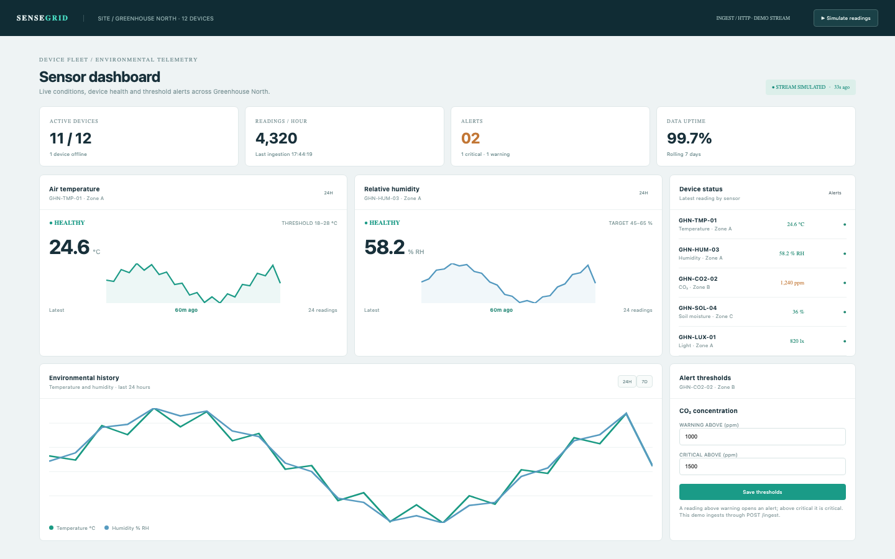

# Sensor Dashboard

An IoT operations dashboard: 12 greenhouse devices (11 online, 1 offline), 4,320 readings an hour, one critical and one warning alert, live sensor cards, a 24-hour/7-day history, device detail with thresholds, an alert log with acknowledgement, and a validated HTTP ingest contract. The stream is simulated; the app does not claim a live sensor connection.

## Run it

```sh
npm install
npm start
```

Open the address it prints (the app keeps its data in `.acryl/`). `npm test` runs the suite with `node:test`; it needs no port and no credentials. The tests pin `TZ=UTC` and also pass under `TZ=America/Los_Angeles` and `TZ=Asia/Tokyo`:

```sh
TZ=America/Los_Angeles npm test
TZ=Asia/Tokyo npm test
```

## What is here

- **Dashboard** (`/`): active devices, readings per hour, open alerts (critical and warning) and uptime, the temperature and humidity cards, the five latest device readings, the 24h/7d history chart and the CO2 threshold editor.
- **Devices** (`/devices`, `/devices/:id`): the inventory with an online/offline filter, and a device detail with status, latest value, a 48-reading chart, thresholds and recent alerts.
- **Alerts** (`/alerts`): threshold crossings with severity, state and timestamps, an open/acknowledged filter and the acknowledge action.
- **Ingest** (`/ingest`): POST `{ deviceId | code, value, unit, timestamp? }`; the device, unit and ISO timestamp are validated, a reading is recorded and a crossed threshold opens an alert.
- **Simulate readings** in the top bar appends a reading for every online device.

Every screen is its own Cordis plugin in `plugins/`, with a row in `blend.yaml` and a `plugin.json`. Settings > Plugins switches any of them off and only that feature leaves: turn `alerts` off and `/alerts` disappears while the dashboard keeps working.

## Notes on the design

The seed makes the mockup's numbers real: 12 devices, 11 online, 288 stored readings, 4,320 readings an hour (12 devices at one every 10 seconds), two open alerts (one warning CO2 and one critical temperature) and 99.7% uptime. The latest seeded reading of each device is exactly its display value, so the cards read 24.6 °C, 58.2 % RH, 1,240 ppm, 36 % and 820 lx like the mockup; older samples carry the deterministic variation.

The boundaries follow the engineering books: `plugins/sensors` is pure domain code with an injected `Store`, `clock` and `newId` (Clean Architecture's dependency rule; DDD Distilled's device, reading, threshold and alert language), and each screen is its own plugin (A Philosophy of Software Design: module depth). Ingest is the only outside effect and it validates identity, unit and timestamp before a reading exists.

## What to ask the chat next

- Ingest a 1,700 ppm CO2 reading and show the new critical alert on the log.
- Filter the device inventory to offline units and open the water flow profile.
- Change the CO2 warning to 1,100 ppm, acknowledge the critical alert and explain what the dashboard now shows.

## Screenshot


