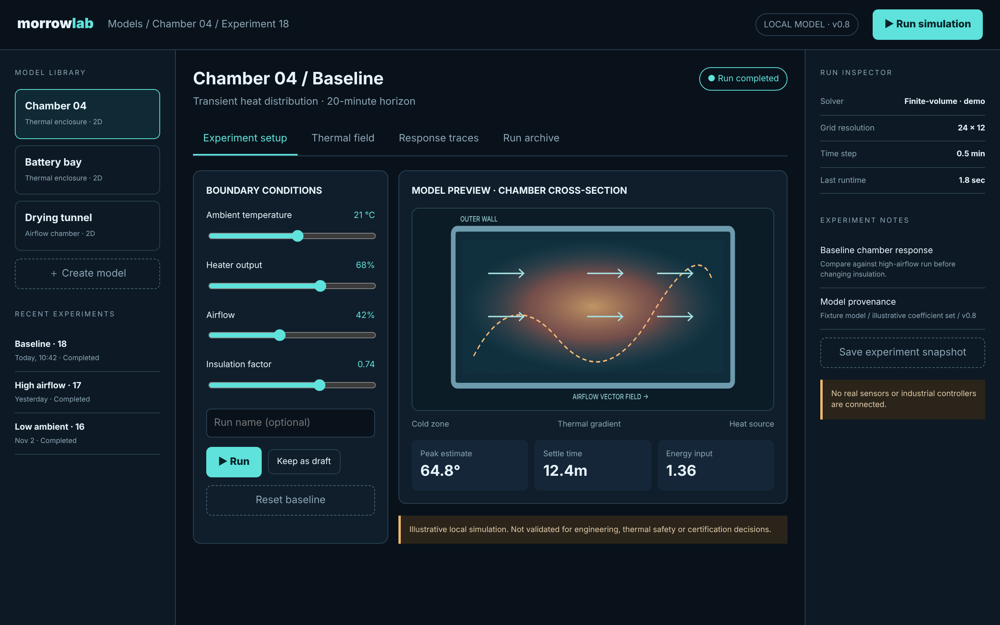

# Morrow Lab

Explore system behavior through reproducible experiments.

An ACRYL Blends blueprint for the **Simulation** category (`acrylblends.simulation-morrow-lab`, category 51 of 100): a compact simulation
workbench for running seeded thermal-chamber experiments, adjusting assumptions, comparing response traces and keeping experiment snapshots.



## Who it is for

Engineers, researchers, educators and product teams who want a starting point for a simulation tool: parameters in, a deterministic model, traces
out, and every run kept so two can be compared.

## Start it

```sh
npm create acrylblends@latest my-lab -- --from acrylblends.simulation-morrow-lab
cd my-lab
npm install
npm start      # the app on its own server; npm run dev opens it in the ACRYL frame
npm test       # domain and route tests
```

The first start seeds three models (Chamber 04, Battery bay, Drying tunnel), three completed runs of Chamber 04 and one snapshot. The lab is
saved as JSON in the app's data home (`.acrylblends/morrow-lab.json`); delete that file to start from the seed again.

## What it does

| Screen | Path | What you can do |
| --- | --- | --- |
| Experiment setup | `/` | Move ambient temperature, heater output, airflow and insulation; run the model (optionally naming the run), keep the values as a draft, or reset to the baseline. The cross-section and the peak, settle time and energy follow. |
| Thermal field | `/field` | The chamber's end temperature on the 24 × 12 solver grid as a heat map, for the latest run or any run (`?run=`). |
| Response traces | `/traces` | Probe A over the 20-minute horizon, a second run overlaid to compare (`?run=&compare=`), the three probes' end values with their difference, and **Export CSV** (`/traces.csv`). |
| Run archive | `/archive` | Every run with links to its trace and field and "Compare with latest"; saved snapshots to load back into the setup or delete. |

The left column is the model library (select or create a model, recent experiments); the right column is the run inspector (solver settings,
last runtime, notes, **Save experiment snapshot**).

## How it is made

Composed from Cordis plugins only; `blend.yaml` reads as what the app is made of:

| Row | Folder | Job |
| --- | --- | --- |
| `morrow-lab` | `plugins/morrow-lab/` | The domain (`ctx.lab`): types, the deterministic model (`simulate`, `thermalField`, `tracesCsv`), seed, and persistence behind a small store port. |
| `lab-shell` | `plugins/lab-shell/` | The page shell (`ctx.labShell`): top bar, three columns, heading, tabs, the mockup's styles and the SVG charts. |
| `library` | `plugins/library/` | The left column and its model routes. |
| `inspector` | `plugins/inspector/` | The right column and the snapshot route. |
| `setup`, `field`, `traces`, `archive` | `plugins/<name>/` | One plugin per tab, each registering its tab so it leaves with the plugin. |

Switch any page off in Settings > Plugins (or `disabled: true` on its row) and its tab and links go with it.

## Prototype boundaries

The numerical model is illustrative seed logic, not a validated engineering or safety model. Do not use it for design certification, physical
control or safety-critical decisions. There is no external solver, no hardware connection, no account, key or network call.

## Ask the chat next

1. "Replace the first-order model in `plugins/morrow-lab/domain.ts` with an explicit finite-volume step over the 24 × 12 grid, keep `simulate` deterministic, and add domain tests for its energy balance."
2. "Add a parameter sweep page: pick one parameter, a range and a step, run them all and chart peak temperature against the parameter."
3. "Version the parameter sets: every run and snapshot records which version of the model it used, and the archive warns when two compared runs used different versions."

Design: `design/spec.md` and `design/mockup.html`.
