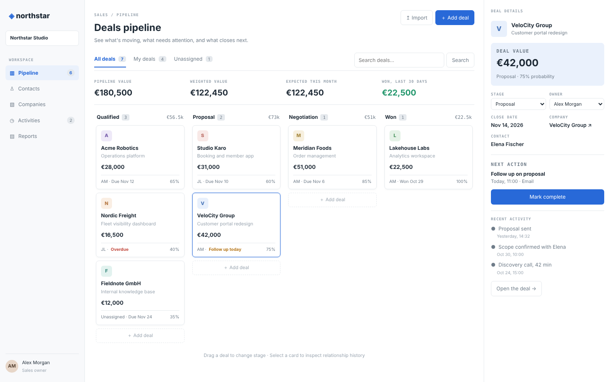

# Small CRM

A relationship-first CRM for a small sales team: a four-stage deals pipeline you drag cards across, an inspector that shows a deal's value, owner,
next action and history without opening it, a contacts directory, company profiles, a follow-up queue and a lightweight pipeline report.

An ACRYL Blends blueprint for the **Business** category (`acrylblends.small-crm`, category 03 of 100).



## Who it is for

Founders, freelancers and sales teams of two to ten people who want their deals, the people behind them and the next step on each in one place,
on their own computer, without a CRM subscription.

## Start it

```sh
npm create acrylblends@latest my-crm -- --from acrylblends.small-crm
cd my-crm
npm install
npm start      # the app on its own server; open the address it prints
npm run dev    # the same app inside the ACRYL frame, with the chat
npm test       # domain rules and every route
```

The first start shows the seed: Northstar Studio's seven deals across Qualified, Proposal, Negotiation and Won, seven companies, seven contacts
(one without a company), an unassigned deal, a follow-up due today and one overdue. Everything you add is saved as JSON in the app's data home
(`small-crm.json`); delete that file to start from the seed again.

## What it is made of

Every feature is a Cordis plugin in `plugins/<feature>/` with its own row in `blend.yaml`:

| Row | What it does |
|---|---|
| `crm` | The domain: companies, contacts, deals, activities and follow-ups, the pipeline rules (stages, probabilities, won / lost confirmation, totals, the report), saved through a store port. |
| `crm-shell` | The sidebar and the look every page shares. |
| `pipeline` | The board (`/pipeline`, and `/` goes there), its tabs, search, totals, drag-and-drop, the inspector and the new-deal form. |
| `deals` | One deal (`/deals/:id`): details, owner, close date, contact, next action, activity log, won / lost confirmation. |
| `contacts` | The directory (`/contacts`), contacts without a company, a form and a CSV import. |
| `companies` | Companies (`/companies`) and each profile (`/companies/:id`) with its contacts, deals and activity. |
| `activities` | The follow-up queue (overdue first) and the timeline (`/activities`). |
| `reports` | The pipeline report (`/reports`). |

Switch a page off in Settings > Plugins (or `disabled: true` on its row) and it leaves the sidebar with its routes.

## Try next in the chat

1. "Add a Lost column to the board that shows lost deals with their reason, collapsed by default."
2. "Send me a reminder on the home page every morning listing the follow-ups that are due today or overdue."
3. "Add a CSV export of the pipeline with company, deal, value, stage, owner and close date."

## Design

`design/spec.md` is the specification and `design/mockup.html` the mockup this app was built to.

Listed on https://acrylblends.github.io/blends and https://acryl.dev/blends.
