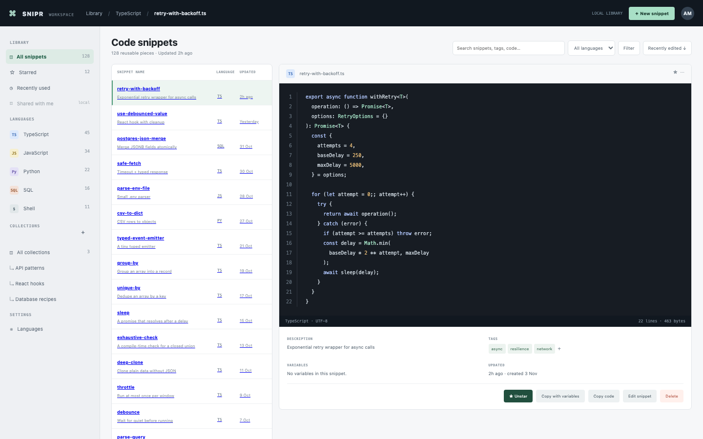

# Snippet Manager

A developer's snippet vault: 128 reusable code snippets with tags, variables, syntax-coloured previews, search and collections. Composed from Cordis plugins: the snippet library, the page shell, the library, the editor, collections and the language settings.

## Run it

```sh
npm install
npm start
```

Open the address it prints. `npm test` runs the tests (node:test; no network, no key).

## What to ask the chat next

- Add a collection for database migrations and put the SQL snippets in it.
- Show the code with its {{variables}} filled from the form and copy it.
- Add a new language and the extension its snippets get in Settings > Languages.

## Screenshot


