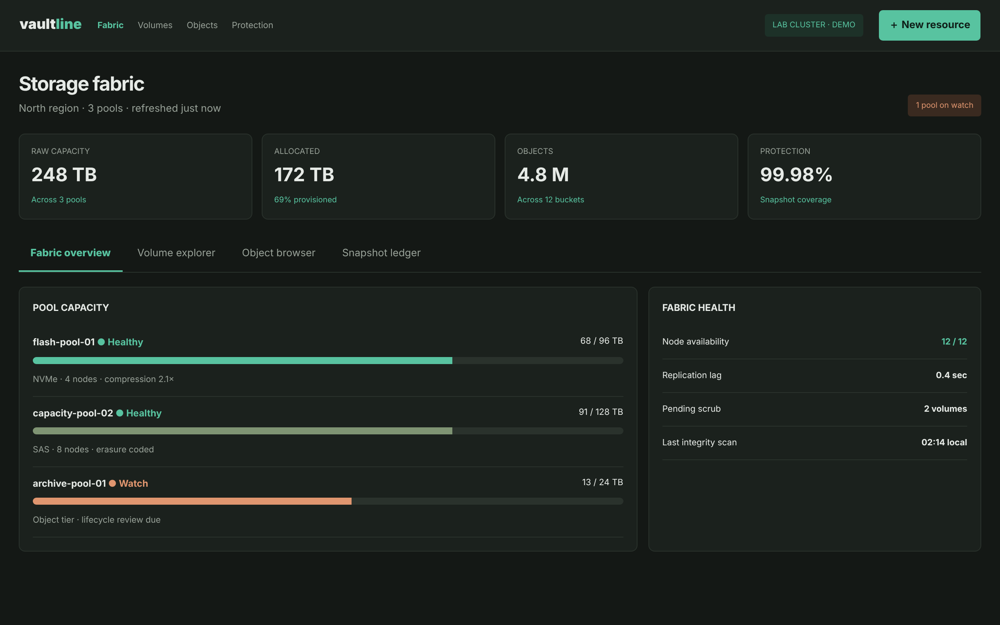

# Vaultline

Run a storage fabric from one calm, capacity-first console.

An ACRYL Blends blueprint for the **Storage** category (`acrylblends.storage-vaultline`, category 54 of 100): pool capacity and health, logical
volumes created against free capacity, object buckets with browsable metadata, and a snapshot ledger with retention.



## Who it is for

Storage administrators, platform engineers, backup operators and developers working with storage services.

## Start it

```sh
npm create acrylblends@latest my-fabric -- --from acrylblends.storage-vaultline
cd my-fabric
npm install
npm start      # the app on its own server; npm run dev opens it in the ACRYL frame
npm test       # domain and route tests
```

The first start seeds a lab cluster: three pools (248 TB raw, 172 TB allocated), four volumes, twelve buckets holding 4.8 million objects (a sample is
listed) and three verified snapshots. State is saved as JSON in the app's data home (`.acrylblends/vaultline.json`); delete it to start over.

## What it does

| Screen | Path | What you can do |
| --- | --- | --- |
| Fabric overview | `/` | Pool capacity with health meters, and the fabric's health: nodes, replication lag, pending scrubs, last integrity scan. |
| Volume explorer | `/volumes` | The logical volumes; **Create volume** checks the pool's free capacity and the name, and the volume starts *Provisioning*; Activate, Scrub, or Delete an empty one. |
| Object browser | `/objects` | Pick a bucket and walk its prefixes; open an object for its type, size, version, encryption, ETag and tags; **New bucket**. |
| Snapshot ledger | `/snapshots` | Every restore point with size and retention; record one (queued), verify it, and purge one whose retention has run out. |

The four statistics above the tabs are computed: raw and allocated capacity from the pools and volumes, objects from the buckets, and protection as
the share of provisioned volume capacity covered by a verified, unexpired snapshot.

## How it is made

Composed from Cordis plugins only; `blend.yaml` reads as what the app is made of:

| Row | Folder | Job |
| --- | --- | --- |
| `vaultline` | `plugins/vaultline/` | The domain (`ctx.vault`): pools, volumes, buckets, objects, snapshots, capacity and retention rules, persistence behind a store port. |
| `vault-shell` | `plugins/vault-shell/` | The page shell (`ctx.vaultShell`): top bar, statistics, tabs and the mockup's styles. |
| `fabric`, `volumes`, `objects`, `snapshots` | `plugins/<name>/` | One plugin per tab, each registering its tab (and top-bar link) so it leaves with the plugin. |

## Prototype boundaries

A fictional lab cluster. No storage system is contacted, no byte is stored and no real object is browsed; the object metadata is seed data.

## Ask the chat next

1. "Add backup policies: a policy per volume with a schedule and retention, and make the ledger create the scheduled snapshot records itself when they are due."
2. "Let me upload a small file in the object browser; store its metadata (size, type, version) and bump the version when the same key is uploaded again."
3. "Add a capacity forecast to the fabric overview: from the allocation history, show when each pool reaches 90%."

Design: `design/spec.md` and `design/mockup.html`.
