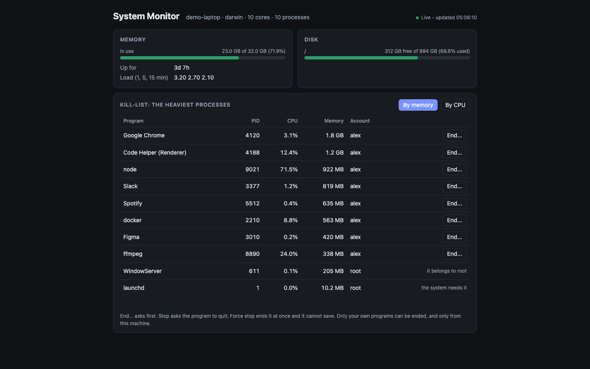

# System Monitor

This machine's memory, disks and processes on one page, refreshed every two seconds, with a kill-list: the heaviest programs, each with an **End...** button that asks first.



**For** anyone who wants to know what is slowing their computer down and stop it without opening a terminal: a developer with a runaway build, a person whose fans just started.

## Start it

```sh
npm install
npm run dev        # inside the ACRYL frame; prints its address
npm start          # the app alone
npm test
```

Set `ACRYLBLENDS_PORT` to choose the first port tried. It reads this machine only and calls no service, so it needs no key and no network.

## What is on the page

- **Memory**: what is in use out of the total. On macOS and Linux this counts what the system could give back (caches) as free, the way Activity Monitor and `free` do.
- **Disk**: the system drive, used and free.
- **Kill-list**: the ten heaviest processes by memory or by CPU. **End...** offers **Stop** (asks the program to quit) and **Force stop** (ends it at once, nothing is saved). The system's first process, the monitor itself, the program that started it and other accounts' programs have no button.
- It runs on macOS, Linux and Windows (Windows shows no CPU share: `tasklist` does not report one).

## Ask the chat next

1. "Add a history: keep the last hour of memory and CPU readings and draw them as two small line charts."
2. "Let me pin a program to a watch-list, and show a warning at the top when one of them uses more than a gigabyte."
3. "Add a Network card with bytes sent and received per second, and a list of the programs that hold open connections."

## How it is built

`src/monitor.ts` is the plugin (routes), `src/monitor/system.ts` reads the machine behind one `Sources` object, `src/monitor/kill-list.ts` holds the rules for what may be ended, and `src/monitor/page.tsx` renders the page. The tests use a fake machine, so they never end a real process. `AGENTS.md` describes the layout for an agent.
