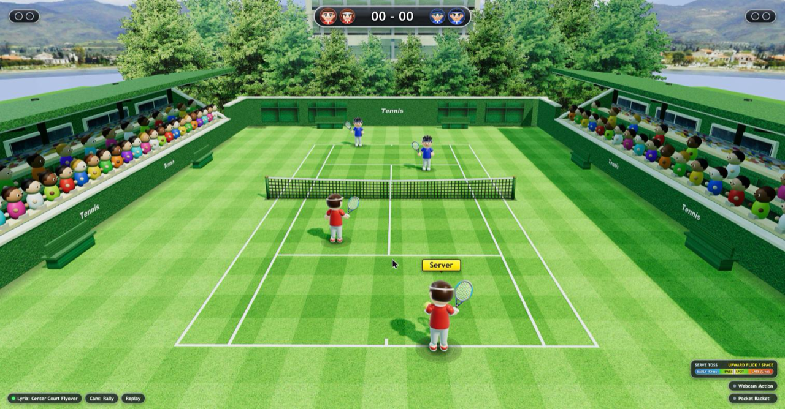

# Tennis

A 3D arcade tennis game in the browser: singles and doubles, topspin, slice and lob, slow-motion power serves and an instant replay, with your phone as a motion racket and a 1v1 match mode.



A Blend for [acrylblends](https://acrylblends.github.io): a whole app whose first screen is the game. Start your own copy, play it, and change it
by hand or with the agents in the ACRYL frame.

## Start your copy

```bash
npm create acrylblends@latest my-tennis -- --from acrylblends.tennis
cd my-tennis
npm install
npm start      # the game on its own server, at the address it prints
npm run dev    # the game in the ACRYL frame, with the agents beside it
```

Or straight from this repository: `npm create acrylblends@latest my-tennis -- --from github:acrylblends/41-tennis`.

## Play

Move with WASD or the arrow keys, swing with the mouse as the ball reaches you, serve with Space, and pick topspin, slice or lob with 1, 2 and 3. Phone Controller shows a QR code that makes a phone on the same network your racket.

## How it is made

- `plugins/game/`: the game's files in `public/`, served at the app's root (`/` on its own server, `/app/` in the frame). A path the game
  does not have goes on to the app's own routes, so `/health` and `/about` still answer.
- `plugins/relay/`: the match relay. A phone opens `companion.html` and posts its swings; the game polls the match state. Rooms live in memory. Tested in `test/relay.test.ts`.
- `blend.yaml`: the app as data. The `game` row comes before `routes`, so the game owns the first screen; switch it off with `disabled: true`.
- Everything else is the acrylblends app: `npm test`, `npm run check`, `npm run save`.

## Credits and licence

Made from a game in the Argon games collection by Ammaar Reshi, with permission. MIT, see `LICENSE` and `NOTICE`.
