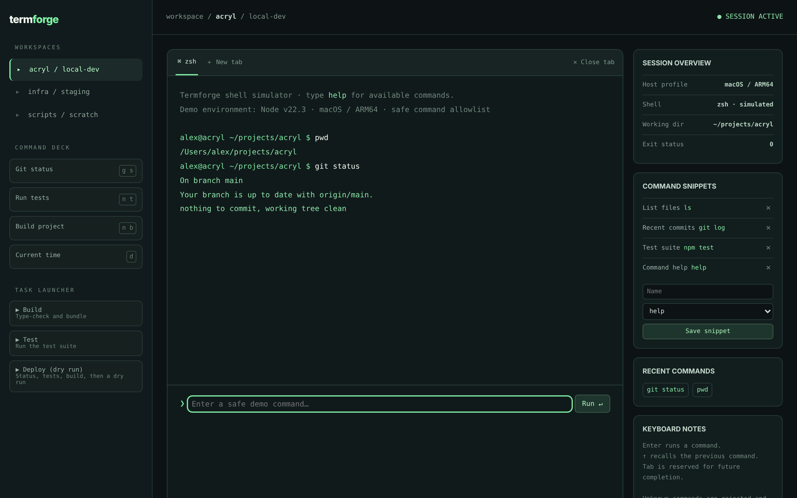

# Termforge

A command workspace for repeatable work, not just a prompt.

An ACRYL Blends blueprint for the **Terminal software** category (`acrylblends.terminal-termforge`, category 65 of 100): a simulated terminal workspace with tabs, a strict command allowlist answered from fixtures, a command deck, a task launcher, saved snippets, command history and recall, and a session status panel. It never starts a host process.



## Who it is for

Developers, platform engineers and technical users who prefer keyboard-driven interfaces.

## Start it

```sh
npm create acrylblends@latest my-terminal -- --from acrylblends.terminal-termforge
cd my-terminal
npm install
npm start      # the app on its own server; npm run dev opens it in the ACRYL frame
npm test       # domain and route tests
```

The first start seeds three workspaces (acryl / local-dev, infra / staging, scripts / scratch); the first has the mockup's `pwd` and `git status` already run, and four snippets are saved. State is saved as JSON in the app's data home (`.acrylblends/termforge.json`); delete it to start over.

## What it does

| Screen | Path | What you can do |
| --- | --- | --- |
| Workspaces | left rail | Switch between workspaces (`?ws=`); each answers the same allowlist with its own fixtures and working directory. |
| Command deck | left rail | Shortcuts (Git status, Run tests, Build project, Current time) that put the command in the prompt (`?cmd=`); you press Run. |
| Task launcher | left rail | Build, Test and Deploy (dry run): a routine runs its commands in order in the current tab and stops at the first failure. |
| Console | `/` | Tabs, the terminal and the prompt. **Run** answers from the fixtures; ↑ and ↓ recall earlier commands; **＋ New tab** and **✕ Close tab**; `clear` empties the tab. |
| Snippets, recent commands, overview | right column | Saved snippets fill the prompt (save a new one from the allowlist, or delete one); recent commands to recall; host profile, working directory and the last exit status; **Clear terminal**. |

The allowlist is `help`, `pwd`, `ls`, `date`, `whoami`, `history`, `clear`, `git status`, `git log`, `npm test`, `npm run build` and `deploy --dry-run`. Anything else is answered `command not available in safe demo mode` with exit status 127; input with shell operators or substitutions (`; | & < > $ ( ) {}` and backticks) is refused with 126. A workspace keeps at most 5 tabs and 100 lines per tab, and at most 12 snippets can be saved.

## How it is made

Composed from Cordis plugins only; `blend.yaml` reads as what the app is made of:

| Row | Folder | Job |
| --- | --- | --- |
| `termforge` | `plugins/termforge/` | The domain (`ctx.forge`): the allowlist parser, the fixtures, tabs, snippets and tasks, saved as JSON in the app's data home. |
| `term-shell` | `plugins/term-shell/` | The shell (`ctx.termShell`): the rail, the top bar, the console area and the status column; side parts are registered by other plugins. |
| `workspaces`, `deck`, `tasks` | `plugins/<name>/` | The left rail. |
| `console` | `plugins/console/` | The first page: tabs, terminal, prompt and the run, clear and tab routes. |
| `snippets`, `session` | `plugins/<name>/` | The right column. |

## Prototype boundaries

This is a browser simulation. It never invokes a host shell, executes a command, reads a file, uses SSH or exposes an environment variable: the answers are fixtures and there is no code path from the prompt to a process.

## Ask the chat next

1. "Add multi-session persistence of command history across restarts and a test proving no input can reach host process execution."
2. "Add tab completion for the allowlist: Tab completes a unique prefix and shows the candidates otherwise."
3. "Add a new workspace type, a database console, with its own allowlist (`show tables`, `explain`) and fixtures, as a plugin."

Design: `design/spec.md` and `design/mockup.html`.
