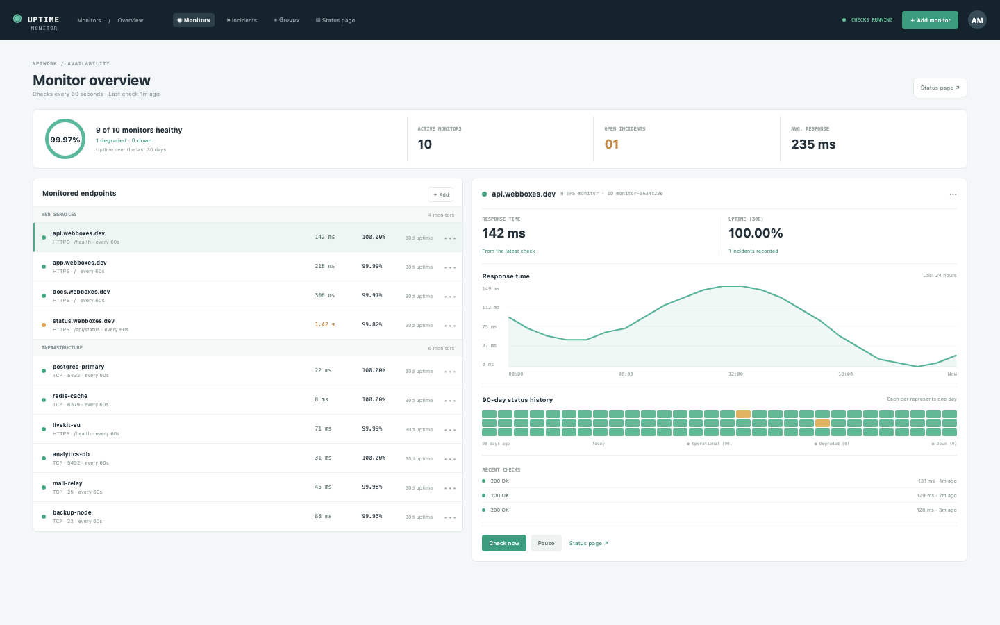

# Uptime Checker

A lightweight availability monitor: hosts and URLs checked on a schedule, with status history, response times and incidents. The check is behind an injected checker, so the tests need no network.

## Run it

```sh
npm install
npm start
```

Open the address it prints. `npm test` runs the tests (node:test; no network, no key).

## What to ask the chat next

- Add a monitor for a URL of yours and check it now.
- Pause the degraded status endpoint and watch the summary change.
- Add a group for the databases and move the three database monitors into it.

## Screenshot


