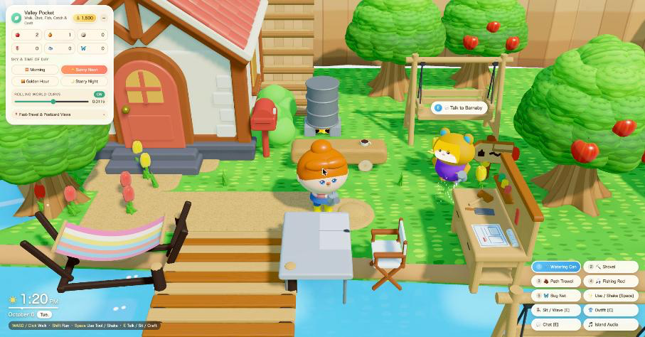

# Valley

A cozy 3D valley life sim on a rolling world: fish, net butterflies, dig, shake fruit trees, craft furniture and trade gifts with the villagers.



A Blend for [acrylblends](https://acrylblends.github.io): a whole app whose first screen is the game. Start your own copy, play it, and change it
by hand or with the agents in the ACRYL frame.

## Start your copy

```bash
npm create acrylblends@latest my-valley -- --from acrylblends.valley
cd my-valley
npm install
npm start      # the game on its own server, at the address it prints
npm run dev    # the game in the ACRYL frame, with the agents beside it
```

Or straight from this repository: `npm create acrylblends@latest my-valley -- --from github:acrylblends/41-valley`.

## Play

Tools on 1 to 4: fishing rod, shovel, bug net and watering can.

## How it is made

- `plugins/game/`: the game's files in `public/`, served at the app's root (`/` on its own server, `/app/` in the frame). A path the game
  does not have goes on to the app's own routes, so `/health` and `/about` still answer.
- `blend.yaml`: the app as data. The `game` row comes before `routes`, so the game owns the first screen; switch it off with `disabled: true`.
- Everything else is the acrylblends app: `npm test`, `npm run check`, `npm run save`.

## Credits and licence

Made from a game in the Argon games collection by Ammaar Reshi, with permission. MIT, see `LICENSE` and `NOTICE`.
