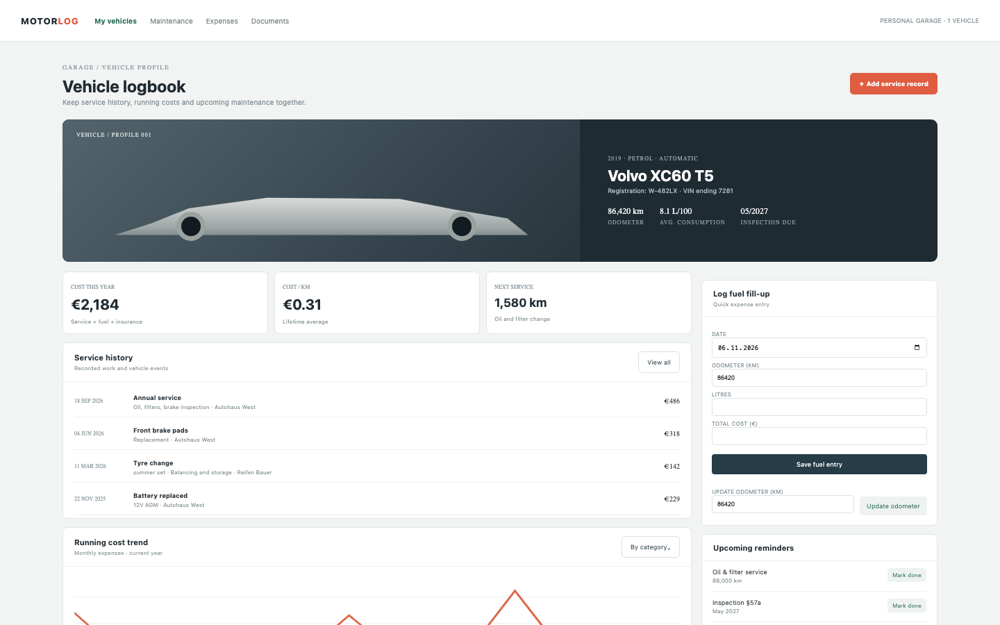

# Vehicle Log

An owner-oriented garage logbook: a Volvo XC60 T5 with 86,420 km, four service records, ten fuel entries, insurance, tax and inspection costs, three reminders, a €2,184 year and a €0.31 lifetime cost per kilometre. The VIN is masked and no live telemetry or regulatory check is claimed.

## Run it

```sh
npm install
npm start
```

Open the address it prints (the app keeps its data in `.acryl/`). `npm test` runs the suite with `node:test`; it needs no port and no credentials. The tests pin `TZ=UTC` and also pass under `TZ=America/Los_Angeles` and `TZ=Asia/Tokyo`:

```sh
TZ=America/Los_Angeles npm test
TZ=Asia/Tokyo npm test
```

## What is here

- **Vehicle profile** (`/`): the hero, odometer, consumption and inspection due, cost this year, cost per km, next service, the latest service history, the monthly cost trend, the fuel entry form, the odometer update and the reminders with their due values.
- **Service history** (`/services`, `/services/new`): all records with a type filter, and the add form with date, odometer, provider, description, cost and parts validation.
- **Expenses** (`/expenses`): service, fuel and other costs broken down by category, the dated list, the cost per km and the add-expense form.
- **Documents** (`/documents`): registration, the masked VIN and the vehicle identity.

Every screen is its own Cordis plugin in `plugins/`, with a row in `blend.yaml` and a `plugin.json`. Settings > Plugins switches any of them off and only that feature leaves: turn `expenses` off and `/expenses` disappears while the profile keeps working.

## Notes on the design

The seed makes the mockup's numbers real: the four service records, ten fuel entries and three expenses total exactly €2,184 this year, and the opening lifetime cost makes the €0.31 per km. The next service is 1,580 km because the oil reminder is due at 88,000 km. Fuel and service entries move the odometer forward only; a failed save rolls the in-memory state back. Currency, fuel unit and dates live in the vehicle record and the formatters.

The boundaries follow the engineering books: `plugins/garage` is pure domain code with an injected `Store`, `clock` and `newId` (Clean Architecture's dependency rule; DDD Distilled's vehicle, service, fuel and reminder language), and each screen is its own plugin (A Philosophy of Software Design: module depth).

## What to ask the chat next

- Add a 50 litre fuel entry at 86,900 km for €90 and show the new cost per km.
- Add an oil service at 86,800 km with parts and verify the next-service reminder.
- Mark the insurance renewal complete and explain what the reminder list now shows.

## Screenshot


