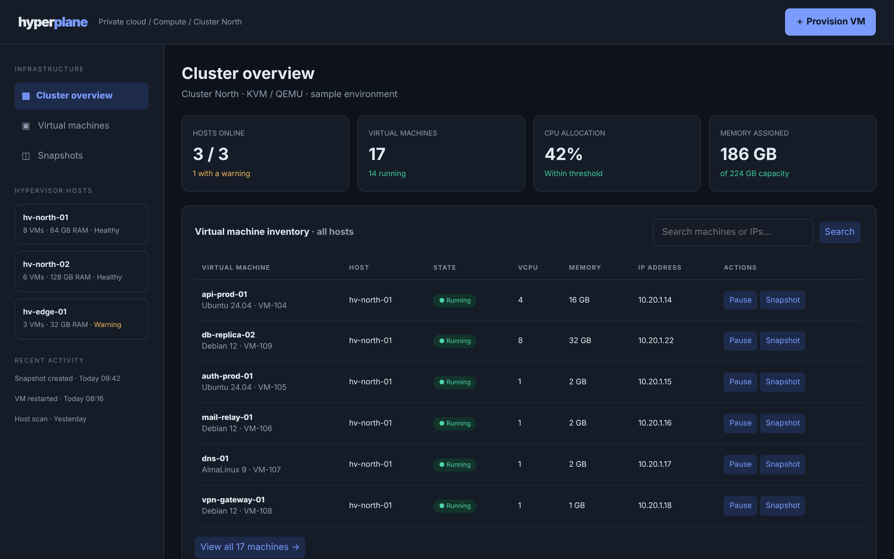

# Hyperplane

Operate a virtual fleet from one clean control surface.

An ACRYL Blends blueprint for the **Virtualization** category (`acrylblends.virtualization-hyperplane`, category 52 of 100): a virtualization
console for choosing a host, reading its allocation, searching the machine inventory and exercising safe local VM state transitions.



## Who it is for

Infrastructure engineers, platform operators and internal IT teams who want a starting point for a fleet console.

## Start it

```sh
npm create acrylblends@latest my-fleet -- --from acrylblends.virtualization-hyperplane
cd my-fleet
npm install
npm start      # the app on its own server; npm run dev opens it in the ACRYL frame
npm test       # domain and route tests
```

The first start seeds Cluster North: three hosts, 17 machines (14 running, one paused, two stopped) and two snapshots. State is saved as JSON in the
app's data home (`.acrylblends/hyperplane.json`); delete the file to start from the seed again.

## What it does

| Screen | Path | What you can do |
| --- | --- | --- |
| Cluster overview | `/` | KPIs, the inventory (pick a host in the rail with `?host=`, search with `?q=`), resource allocation of the cluster or the picked host, recent snapshots. |
| Virtual machines | `/machines` | Filter by search text, host, state and OS; start, pause, resume and snapshot from the row. |
| Machine detail | `/machines/:id` | Allocation against its host, lifecycle buttons, a labelled snapshot, its snapshots and events, and Remove for a stopped machine. |
| Provision VM | `/machines/new` | Name, host (with its free memory), image, vCPU, memory and disk; the machine starts in **Provisioning**. |
| Snapshots | `/snapshots` | Every restore point; delete one. |

The lifecycle is a small state machine (`TRANSITIONS` in `plugins/hyperplane/domain.ts`): stopped, paused and provisioning machines start;
running ones pause or stop; paused ones stop. Starting a stopped machine and provisioning a new one are guarded by the host's free vCPU, memory
and SSD, and the refusal names what is missing. A machine gets its address from its host's subnet when it first starts, and keeps at most five
snapshots.

## How it is made

Composed from Cordis plugins only; `blend.yaml` reads as what the app is made of:

| Row | Folder | Job |
| --- | --- | --- |
| `hyperplane` | `plugins/hyperplane/` | The domain (`ctx.fleet`): types, the lifecycle, capacity maths, filters, seed, persistence behind a store port. |
| `fleet-shell` | `plugins/fleet-shell/` | The page shell (`ctx.fleetShell`): top bar, sidebar with pages, hosts and activity, the machine table, the mockup's styles. |
| `overview`, `machines`, `snapshots` | `plugins/<name>/` | One plugin per area, each registering its sidebar entry so it leaves with the plugin. |

Switch a page off in Settings > Plugins (or `disabled: true` on its row) and its entry, its links and its action buttons go with it.

## Prototype boundaries

Every host and machine is a fictional local fixture. Lifecycle actions change only this app's saved state and never call a hypervisor, a cloud
provider or a host API. No account, key or network call is needed.

## Ask the chat next

1. "Add a pending-actions queue: start and snapshot requests are queued, applied one by one with a short delay, and a failed one rolls back with a visible error."
2. "Add storage pools and networks as two more plugins, each with its own page and sidebar entry, and let a machine attach to a pool."
3. "Add live migration: move a running machine to another host if that host has room, with an event in the activity log."

Design: `design/spec.md` and `design/mockup.html`.
