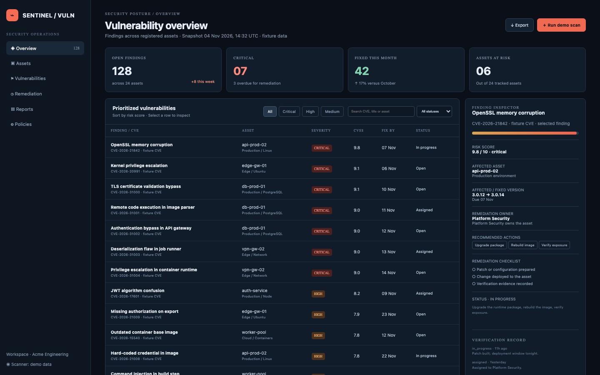

# Vulnerability Tracker

A security-operations console for triaging findings against registered assets: 24 assets, 128 open findings, 7 critical, 42 fixed this month and 6 assets at risk. Every CVE is fixture data; the console never scans a network and never claims a fix without a recorded verification.

## Run it

```sh
npm install
npm start
```

Open the address it prints (the app keeps its data in `.acryl/`). `npm test` runs the suite with `node:test`; it needs no port and no credentials. The tests pin `TZ=UTC` and also pass under `TZ=America/Los_Angeles` and `TZ=Asia/Tokyo`:

```sh
TZ=America/Los_Angeles npm test
TZ=Asia/Tokyo npm test
```

## What is here

- **Overview** (`/`): open findings, critical count, fixed this month and assets at risk, the prioritized table with severity and status filters and search, and the finding inspector. The inspector shows the affected and fixed versions, the remediation checklist and the verification record, and lets you assign an owner, start remediation, accept a risk or record a verified remediation.
- **Vulnerabilities** (`/findings`, `/findings/:id`): the same table filtered, or a finding selected in the inspector.
- **Assets** (`/assets`): the 24 registered assets with environment, platform, owner, criticality and open findings.
- **Remediation** (`/remediation`): the console-wide append-only audit trail, newest first, with an action filter.
- **Reports** (`/reports`, `/export.json`, `/export.csv`): severity and status distributions, the assets at risk, and the JSON and CSV exports.
- **Policies** (`/policies`): the remediation windows by severity and the evidence rule the console enforces.

Every screen is its own Cordis plugin in `plugins/`, with a row in `blend.yaml` and a `plugin.json`. Settings > Plugins switches any of them off and only that feature leaves: turn `reports` off and `/reports`, `/export.json` and `/export.csv` disappear while the overview keeps working.

## Notes on the design

The seed makes the mockup's numbers real: 24 assets, 128 open findings (7 critical), 42 remediated in November and 36 in October (the 17% velocity), 6 assets with open critical or high findings, 3 overdue and 8 opened this week. The mockup's first six findings keep their exact CVEs, CVSS scores, due dates and statuses; the back catalogue is deterministic.

The evidence gate is a domain rule, not a UI hint: `remediate` refuses without a patch, test or scan reference, records the evidence on the finding and appends an event. Accepted risk is a separate recorded decision. The boundaries follow the engineering books: `plugins/vulns` is pure domain code with an injected `Store`, `clock` and `newId` (Clean Architecture's dependency rule; DDD Distilled's asset, finding and remediation-event language), and each screen is its own plugin so it can be switched off (A Philosophy of Software Design: module depth).

## What to ask the chat next

- Assign CVE-2026-20991 to Platform Security, start remediation and record a scan id as the evidence.
- Filter to accepted findings and explain why they do not count as fixed.
- Export the CSV and confirm the remediated findings carry their evidence column.

## Screenshot


