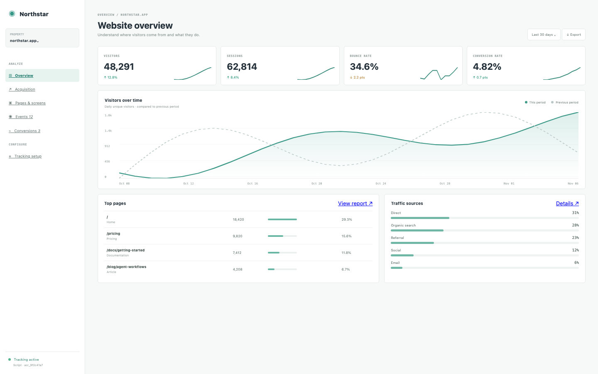

# Web Analytics

A privacy-conscious website analytics console: a tracking snippet, page-view events in, and a daily dashboard of visitors, sources, pages and conversions. The collect endpoint is CORS-enabled; the snippet stores only a random session id.

## Run it

```sh
npm install
npm start
```

Open the address it prints. `npm test` runs the tests (node:test; no network, no key).

## What to ask the chat next

- Open the tracking page and paste the snippet into a page on another site.
- Add a conversion for a demo request and check the funnel.
- Open the events page and filter it to sign-ups.

## Screenshot


