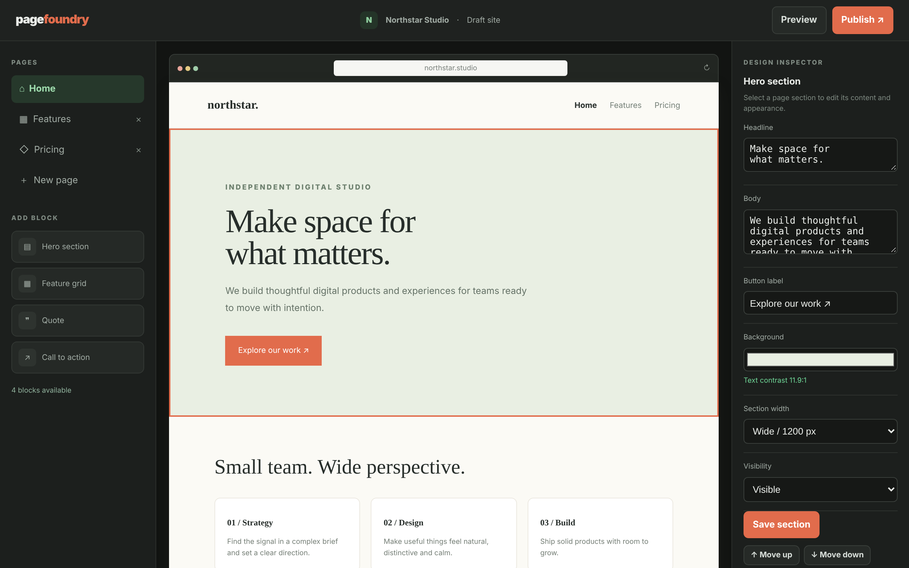

# Pagefoundry

Build a small site from blocks and see it as you edit.

An ACRYL Blends blueprint for the **Web builder** category (`acrylblends.web-pagefoundry`, category 64 of 100): a website builder with a page list, a block library, a browser-framed live preview with selectable sections, a design inspector with a contrast check, desktop and mobile preview, and simulated publishes.



## Who it is for

Designers, makers and small teams who want to assemble a landing site without code.

## Start it

```sh
npm create acrylblends@latest my-web-builder -- --from acrylblends.web-pagefoundry
cd my-web-builder
npm install
npm start      # the app on its own server; npm run dev opens it in the ACRYL frame
npm test       # domain and route tests
```

The first start seeds Northstar Studio with three pages (Home, Features, Pricing) built from hero, feature grid and call-to-action blocks. State is saved as JSON in the app's data home (`.acrylblends/pagefoundry.json`); delete it to start over.

## What it does

| Screen | Path | What you can do |
| --- | --- | --- |
| Pages | left column | The site map with the current page highlighted (`?page=`); **New page** adds a page with a hero, × deletes any page but the first. |
| Add block | left column | Hero, feature grid, quote and call to action; a click appends the block to the page and selects it. |
| Canvas | `/` | The page in a browser frame; clicking a section selects it (`?section=`). **Preview** hides the panels and offers Desktop and Mobile. |
| Design inspector | right column | Headline, body, button, feature items, background with its text contrast, width and visibility; save, move up or down, delete. |
| Theme and publish | right column, top bar | Accent colour and heading font; **Publish** records a simulated build (v1.0, v1.1, …) and lists it. |

A page holds at most 12 sections and a site at most 8 pages. Text with contrast below 4.5:1 is flagged in the inspector, and a publish records it as a warning. A publish is refused while a page has no sections.

## How it is made

Composed from Cordis plugins only; `blend.yaml` reads as what the app is made of:

| Row | Folder | Job |
| --- | --- | --- |
| `pagefoundry` | `plugins/pagefoundry/` | The domain (`ctx.site`): pages, sections, blocks, contrast, theme, preview mode and builds, saved as JSON in the app's data home. |
| `builder-shell` | `plugins/builder-shell/` | The shell (`ctx.builderShell`): top bar and the three regions; the side columns are parts other plugins register. |
| `pages`, `blocks` | `plugins/<name>/` | The left column. |
| `canvas` | `plugins/canvas/` | The first page, the live preview. |
| `design`, `publish` | `plugins/<name>/` | The right column and the top bar's Preview and Publish. |

## Prototype boundaries

Nothing is deployed: Publish records a simulated build in the local draft, and the domain is a label.

## Ask the chat next

1. "Add a Pricing table block with three plans and a highlighted one, as part of the blocks."
2. "Add undo and redo for edits, keeping the last twenty changes of the draft."
3. "Export the published site as a folder of static HTML files, one per page."

Design: `design/spec.md` and `design/mockup.html`.
