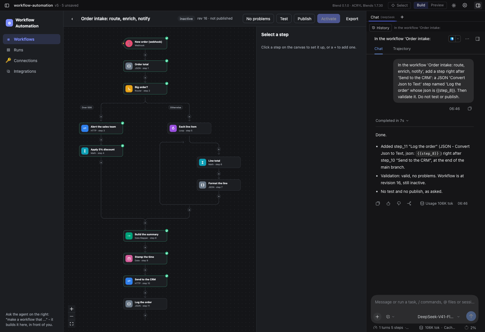
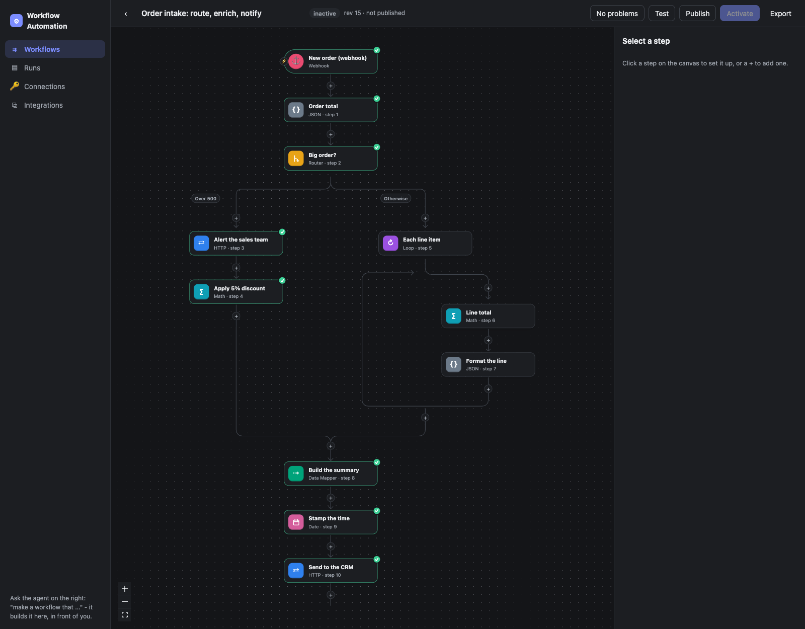
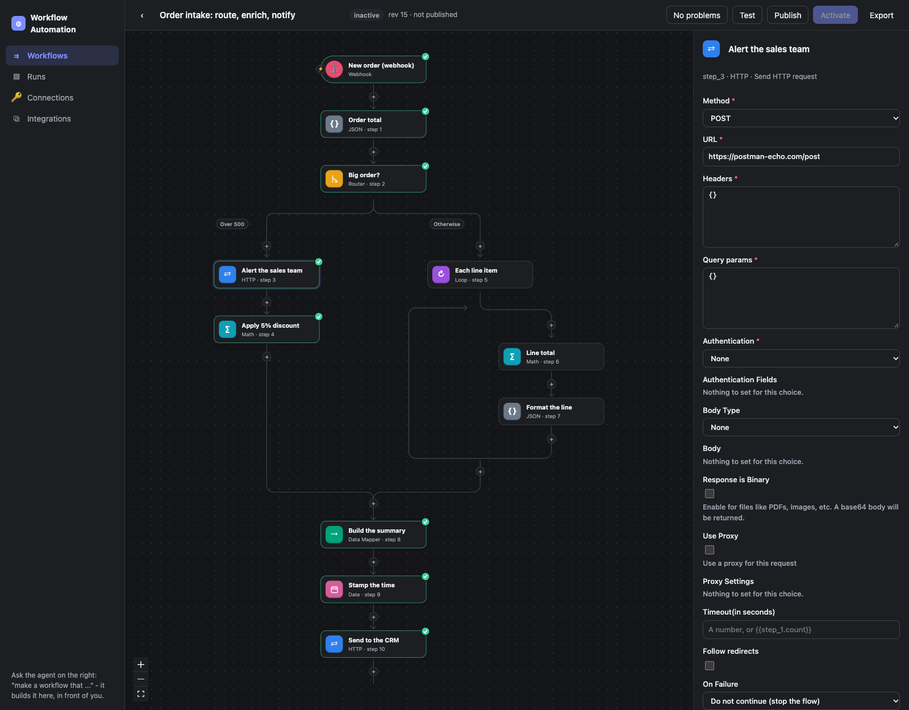
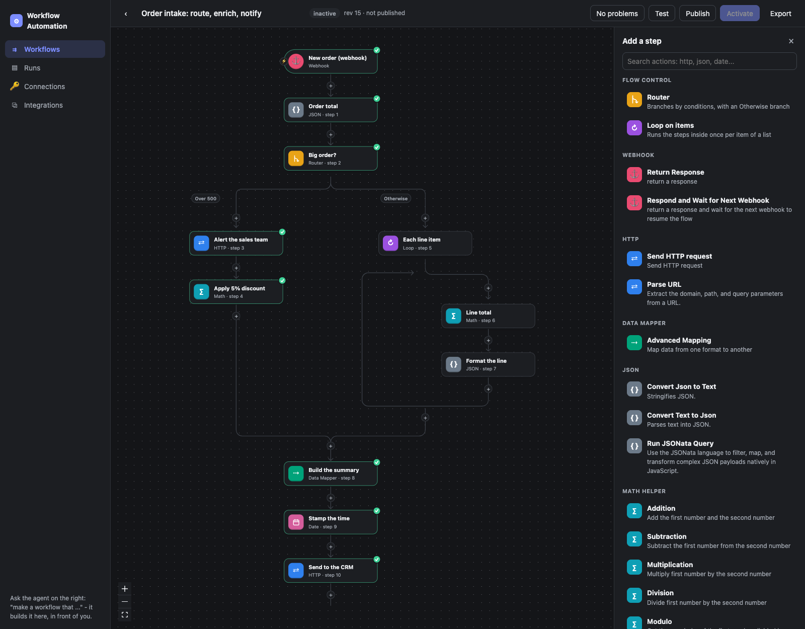
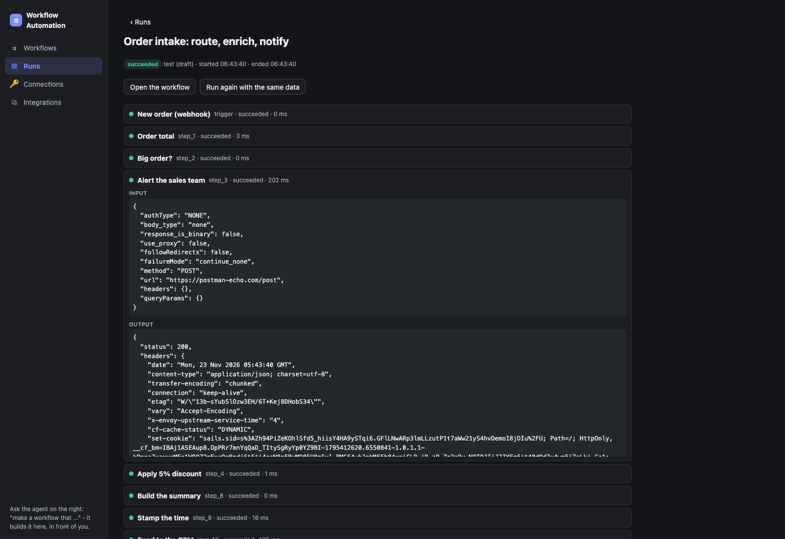

# ACRYL Workflow Automation (Electrobun)

The smallest build of [ACRYL Workflow Automation](https://github.com/acrylblends/48-workflow-automation): an Electrobun window with the system webview, the app host on Bun (no Chromium, no Node). Same app, same source.

Workflow automation in the n8n class, as an ACRYL Blend: build workflows on a canvas, run them on a schedule, a webhook
or by hand, look at every run step by step, and let the ACRYL agent build, test and fix them for you while you watch.



| The pipeline after a test run | A step's settings | Adding a step | A run, step by step |
|---|---|---|---|
|  |  |  |  |

- **Editor**: a canvas (React Flow, Qadam Flow's layout) with routers (branches by conditions) and loops; a form per step
  generated from its integration, with `{{ }}` references to what earlier steps gave.
- **Triggers**: manual, schedule (every hour, day, week, cron), webhook (`/automation/webhooks/<token>`, `/test` runs the draft).
- **Integrations**: HTTP, JSON, data mapper, date, math, delay, from Qadam Flow (MIT) as npm packages.
- **Runs**: durable; every step's input, output, error, duration and attempts; retry and continue-on-failure; delays
  survive a restart.
- **Draft and published**: you edit a draft, publish a version, activate it. Export and import as a file (no secrets).
- **Connections**: API keys and tokens, encrypted in the app's data folder, never shown again, never sent to the agent.
- **The agent**: 21 typed tools (`automation_*`) for the ACRYL chat on the right: it finds actions, builds the graph,
  fills settings, tests and reads runs while you watch the canvas. Publishing, activating, and a test that reaches
  outside the app wait for you to press Approve in the app. Terminal agents (Claude Code, Codex, Pi) drive the screen
  through `.acryl/bin/acryl look` and `act`.

## Install

Ready to install (the latest release, <https://github.com/acrylblends/48-workflow-automation-eb/releases/latest>):

| | Apple silicon / ARM | Intel / x64 |
|---|---|---|
| macOS | [ACRYL-Workflow-Automation-Electrobun-mac-arm64.dmg](https://github.com/acrylblends/48-workflow-automation-eb/releases/latest/download/ACRYL-Workflow-Automation-Electrobun-mac-arm64.dmg) | - |
| Windows | [ACRYL-Workflow-Automation-Electrobun-win-arm64-Setup.zip](https://github.com/acrylblends/48-workflow-automation-eb/releases/latest/download/ACRYL-Workflow-Automation-Electrobun-win-arm64-Setup.zip) | [ACRYL-Workflow-Automation-Electrobun-win-x64-Setup.zip](https://github.com/acrylblends/48-workflow-automation-eb/releases/latest/download/ACRYL-Workflow-Automation-Electrobun-win-x64-Setup.zip) |
| Linux | [ACRYL-Workflow-Automation-Electrobun-linux-arm64-Setup.tar.gz](https://github.com/acrylblends/48-workflow-automation-eb/releases/latest/download/ACRYL-Workflow-Automation-Electrobun-linux-arm64-Setup.tar.gz) | [ACRYL-Workflow-Automation-Electrobun-linux-x64-Setup.tar.gz](https://github.com/acrylblends/48-workflow-automation-eb/releases/latest/download/ACRYL-Workflow-Automation-Electrobun-linux-x64-Setup.tar.gz) |

Windows: unzip and run the Setup. Linux: unpack and run the installer inside. Not signed yet: on macOS right-click the app and choose Open; on Windows, if SmartScreen asks, click More info and then
Run anyway. The release also holds the Electron build of the same app and the measured sizes (sizes-*.json).

Or make your own copy to change: `npx acryl new my-automation github:acrylblends/48-workflow-automation-eb`.

## Develop

```sh
npm install
npm run dev            # the app in the ACRYL frame, with the agent on the right
npm start              # the app on its own server
npm test
npm run check          # type-check (server and screen)
npm run build:studio   # rebuild the screen after editing plugins/automation-studio/client/src
npm run pack:electrobun -- --arch arm64 --out out   # the Electrobun installer (and the Electron one) for this machine
```

Plugins (each a row in `blend.yaml`, each switchable): `automation` (the domain: workflows, runs, connections,
schedules), `automation-api` (JSON API, live events, webhooks), `automation-studio` (the screen), `automation-tools`
(the agent's tools).

Built on [Qadam Flow](https://github.com/aiqadam/qadam-flow) (MIT), itself from Activepieces (MIT). See `NOTICE` and
`docs/upstream-audit.md`. MIT licensed.
