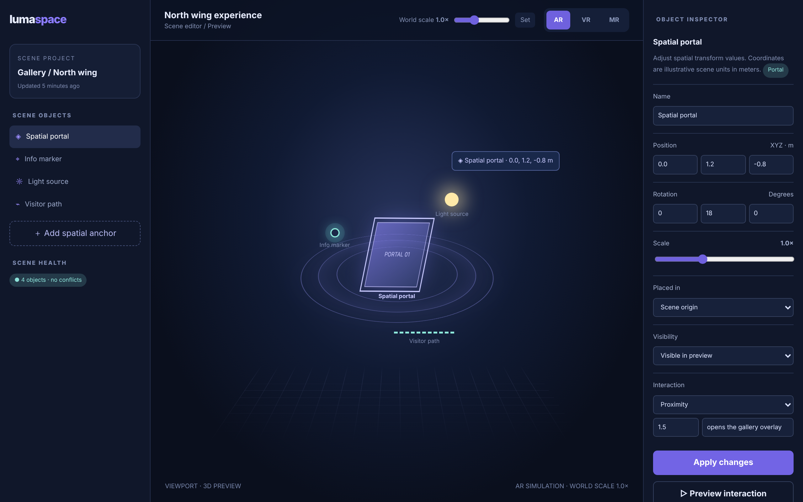

# Luma Space

Compose spatial experiences from scenes, anchors and interactions.

An ACRYL Blends blueprint for the **Extended reality** category (`acrylblends.xr-luma-space`, category 66 of 100): an XR scene composer with a stylised 3D viewport, AR, VR and MR preview modes, an object hierarchy with parent-child transforms in metres, a transform inspector, spatial anchors, a simulated interaction preview and scene validation.



## Who it is for

XR designers, spatial-computing developers and teams prototyping immersive product concepts.

## Start it

```sh
npm create acrylblends@latest my-xr -- --from acrylblends.xr-luma-space
cd my-xr
npm install
npm start      # the app on its own server; npm run dev opens it in the ACRYL frame
npm test       # domain and route tests
```

The first start seeds the North wing experience: a spatial portal, an info marker, a light source and a visitor path, in AR at world scale 1.0×. State is saved as JSON in the app's data home (`.acrylblends/luma.json`); delete it to start over.

## What it does

| Screen | Path | What you can do |
| --- | --- | --- |
| Scene objects | left rail | The project, the object hierarchy (objects placed inside another are indented), **＋ Add spatial anchor**, and the scene health pill. |
| Viewport | `/` | The scene as a stylised 3D view: objects are placed by their world position and scale; click one to inspect it (`?object=`). The AR, VR and MR switch changes the preview, and the world scale slider scales everything. |
| Object inspector | right column | Name, position (m), rotation (°), scale, the object it is placed in, visibility and the interaction (trigger, radius, action); **Apply changes**, **▷ Preview interaction**, **Delete object**. |
| Scene validation | right column | Overlaps, objects outside the scene bounds and hidden objects that still have an interaction. |

Positions are metres within ±10 m, rotations degrees within ±180° (applied Z·Y·X), scales 0.5× to 2×; a scene holds at most 12 objects and names are unique. A child's position is scaled and rotated by its parent before it is added to the parent's. Two visible objects closer than 0.25 m overlap and count as a conflict. An object with children cannot be deleted, and an object cannot be placed inside itself or its own children.

## How it is made

Composed from Cordis plugins only; `blend.yaml` reads as what the app is made of:

| Row | Folder | Job |
| --- | --- | --- |
| `luma` | `plugins/luma/` | The domain (`ctx.scene`): objects, the transform composition, modes, interactions and validation, saved as JSON in the app's data home. |
| `luma-shell` | `plugins/luma-shell/` | The shell (`ctx.lumaShell`): the rail, the viewport area and the inspector column; side parts are registered by other plugins. |
| `objects` | `plugins/objects/` | The rail. |
| `viewport` | `plugins/viewport/` | The first page and the mode and world scale routes. |
| `inspector`, `validation` | `plugins/<name>/` | The right column. |

## Prototype boundaries

The viewport is a visual 3D-style preview, not an XR session. There is no camera passthrough, tracking, eye data, biometric input or mapping of the physical world, and nothing here claims AR safety or spatial accuracy.

## Ask the chat next

1. "Add scene serialization: export the scene as JSON and import it back with validation of every transform and anchor."
2. "Add an undo stack for transform edits, so the last twenty changes can be stepped back and forward."
3. "Add a second viewport view, a top-down plan with a metre grid, that stays in sync with the selected object."

Design: `design/spec.md` and `design/mockup.html`.
